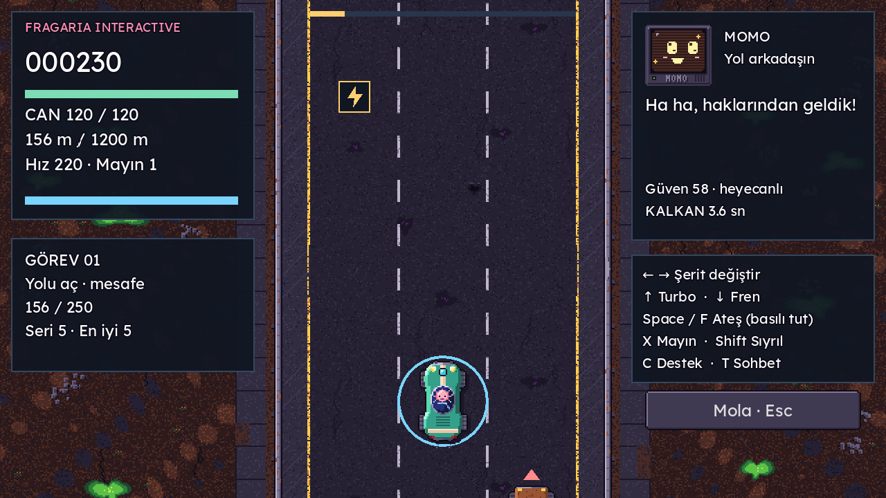
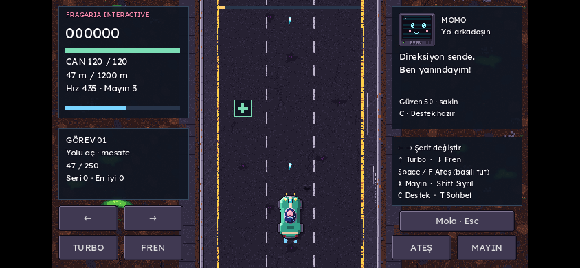

# Arcade Forge · Geliştirme ve doğrulama kaydı

12 Kasım 2026 · Kaynak tabanı `f7fd67082eec6609a66b5e8c40dc5dcea774925f` · Yeni sürüm 0.2.0

## İnceleme sonucu

0.1 sürümünde her harf oyun zamanını %10'a indiren komut kutusunu açıyordu. Şerit değişimi dahi MOMO'nun ruh haline bağlı olarak gecikebiliyordu. HUD metni yolun üstüne taşıyor, amaç yalnızca ölüm gelene kadar ilerlemekti. İkmal çizimleri vardı fakat seferde toplanan destek döngüsü yoktu. Duraklatma, doğrudan dokunmatik sürüş ve ses geri bildirimi yoktu.

Kullanıcının yeni kararı tasarımı değiştirir: anında ok tuşlu sürüş birincildir. MOMO kişilik, ilişki ve garaj hafızasını taşır. İsteğe bağlı sohbet T ile açılır; eski parser testleri korunur. Direksiyon/silah/kaçışın doğrudan girdileri MOMO yorumuna girmez.

## Fragaria / Aionverse kaynaklarının kullanımı

- Drive proje rehberi (özel referans public pakette yok): doğru repo ve yedek yapısı bulundu. Eski yedekler değiştirilmedi.
- [Aion Endless Run](https://github.com/kaansavukduran/aion_endless_run), mevcut README: net doğrudan kontrol, mola, çoklu dokunma, yerel tercihler ve görsel okunabilirlik referansı.
- Save the Planet geliştirme briefi (özel referans public pakette yok): Fragaria Interactive yayıncı adı, kanonik karakterleri koruma, renk yanında şekil, odak kaybında mola ve doğrulama dürüstlüğü ilkeleri. Başka oyuna ait hikâye/bölüm kapsamı bu oyuna taşınmadı.
- Fragaria Classification System taslağı (özel referans public pakette yok): belge kendi kapsamını sınıflandırma olarak tanımlıyor; kalite sertifikası sayılmadı, kayıt kimliği uydurulmadı.

0.2 incelemesinde bağımsız standart henüz bulunamamıştı. Kullanıcının daha sonra verdiği resmî AIONIA klasörüne erişildi; 00_BAŞLA ve standart v1.0 ile 19 görsel incelendi. 0.3 için AIONIA_STANDARD.md, ART_BIBLE.md, GAME_DESIGN.md, LORE_LINKS.md ve QA.md bu tarihli notun önüne geçer. Bu bir sertifikasyon iddiası değildir. Mevcut Aion / Ömer, MOMO, araç ve çevre paftaları değiştirilmedi. Lexend ana yazı tipi korundu, dört ok glifi için lisanslı küçük bir DejaVu alt kümesi eklendi. Fragaria Interactive ve Aionverse isimleri garajda; Fragaria adı sürüş HUD'ında görünür.

## Yeni oyun döngüsü

1. Garajda doğrudan Space ile zırhlı hızlı sürüş veya diyalog + yükseltme.
2. Oklarla şerit değiştir; yukarı okla sınırlı enerji kullanarak turbo, aşağı okla fren. Boşluk/F basılıyken ön/arka en yakın tehdide ateş. X mayın, Shift sıyrılma, C destek.
3. Onarım, enerji/mayın ve tek darbeyi emen kalkan kapsüllerini topla. Şekiller renk bilgisi olmadan da ayırt edilir.
4. Seri puanını büyüt; hasar veya beş saniyelik seri boşluğu çarpanı sıfırlar. Mesafe, düşman ve ikmal görevleri sırasıyla gelir; ödülleri bir kez verilir.
5. 1.200 metrede başarı; ölümde tekrar deneme. Sonuç ekranından tek adımda yeniden sür veya garaja dön. Rekor, güven, hafıza ve tercihler yerelde kalır.

Tüm yeni denge sayıları `data/balance.json` içindeki `run.arcade` alanındadır. Puan/görev mantığı sahneden bağımsız `scripts/core/arcade.gd` içindedir. Yeni sesler dış örnek içermeyen kısa sentezlerdir; müzik eklenmedi.

## Doğrulama

Godot 4.6.3 / Linux çalışma ortamında altı test takımı: parser 110, MOMO 89, garaj/kayıt 72, mevcut sefer 14, yeni arcade sahnesi 32, tam sefer 4; **321 başarılı, 0 başarısız**. Gerçek sahneye klavye ve iki parmak olayları gönderilir. Küs MOMO sırasında gecikmesiz sürüş, turbo tüketimi, fren, ateş/mayın, mola, ayrı parmakların bırakılması, gerçek kapsül çarpışması, tek darbeli kalkan, görev, başarı, ödülün tek verilmesi, rekor ve tercih kaydı sınanır. Sabit 42 tohumlu tam sefer simülasyonunda basit ateş/turbo/ikmal takip stratejisi, 91,15 oyun saniyesinde 1.200 metreye ulaştı: 31 düşman, 17 kapsül, 6 görev ve 5.640 puan. Bu otomatik simülasyondur; insan oyuncu testi değildir.

```sh
bash tests/run_all.sh
python3 packaging/build_web.py
python3 -m http.server 8765 --directory build/web
# Ayrı terminal, Playwright kuruluysa:
DBW_CHROMIUM=/usr/bin/chromium node tests/browser_smoke.cjs
```

Yazma kısıtlı ortamlarda Godot'un XDG_DATA_HOME, XDG_CONFIG_HOME ve XDG_CACHE_HOME yollarını proje içindeki geçici `work/runtime/` altına yönlendirmek gerekir. Test kayıtları oyuncunun gerçek kaydını değiştirmeyen ayrı adlar kullanır.

Web export resmî SHA-512 doğrulamalı şablonlarla üretildi. Derleme kontrolü hem garajı hem gerçek sefer sahnesini açar ve script hatalarında durur. Chromium 1280×720 masaüstü ve 844×390 dokunmatik emülasyonda çalıştırıldı. Mola sırasında yol görüntüsünün sabitliği ve tarayıcı hata kaydı kontrol edilir; ekran görüntüleri ayrıca incelendi. İki parmakla turbo ve ateş aynı anda kullanılabilir. Fiziksel cihaz testi veya insan oyuncu eğlence testi yapılmış sayılmaz.





## Teslim ve sınırlar

Web ZIP'i HTTP sunucusundan oynanır; çift tıklamayla açılmaz. Kaynak ZIP'i Godot projesidir. GitHub geliştirme dalı ana sürümden ayrıdır. Bu çalışma üretim Vercel sitesini değiştirmez ve yeni Windows/Linux/Android native paketi yayımlamaz. Bu hedeflerin mevcut CI/export profilleri korunur; fiziksel kumanda ve telefon, Safari, native kurulumlar ve insanlarla uzun denge testi sonraki doğrulama hedefleridir. Oyun arayüzü Türkçedir. Dikey telefonda alan küçülür; yatay ekran önerilir.

Drive önizleme paketleri (özel teslim; bağlantı kullanıcıyla ayrıca paylaşılır): kaynak, web ve doğrulama arşivi. Eski kaynak yedekleri aynı kimlik ve konumlarıyla korundu.

## 0.3 · Resmî AIONIA uyarlaması

Resmî kaynaklar kullanıcı tarafından sağlandıktan sonra ana menü, yardım, ortak ayarlar, ses düzeyi, dekoratif hareket seçimi, yükleme/hata akışı ve marka hiyerarşisi uygulandı. 332 kontrol PASS. Bulut yazılım renderer 60 FPS hedefi FAIL; fiziksel cihaz ve üretim yayını NOT TESTED. Ayrıntı QA.md içindedir.

0.3 AIONIA teslimleri (özel teslim; bağlantı kullanıcıyla ayrıca paylaşılır) · Önceki 0.2 paketleri korunur.

## 0.4 · Evrensel kalite, kontroller ve yerel veri

Yeni resmî belge okundu; erişimde başlık v1.2 olduğundan istenen v1.1 kapsamıyla birlikte kayda geçirildi. Amaç/kitle/teknoloji ve açıklar DESIGN_BRIEF.md'de. Analog/tetikleyici, A/B menü akışı, yeniden atama, ölü bölge, otomatik ateş, titreşim tercihi, üç sekmeli ayarlar, veri sıfırlama, güvenli onay, kayıt yedeği ve arıza koruması eklendi. Web yardım metni semantiktir; düşük güç modu aynı ekran alanında daha küçük arka tampon kullanır. Android public prototype imzası fallback'i kaldırıldı.

390 otomatik kontrol PASS. Yazılım renderer normal mod 60 FPS kapısı FAIL; düşük güç 30 FPS ara hedefi PASS. Fiziksel cihaz/yardımcı teknoloji/insan eğlence testi ve üretim yayını NOT TESTED. Ayrıntılar QA.md'de.

0.4 teslimleri (özel teslim; bağlantı kullanıcıyla ayrıca paylaşılır). 0.2 ve 0.3 yedekleri korundu.

## 0.5 · Onaylı kaydırma ve Eve Giden Yol

Kullanıcı son olarak telefon/tablette sağa/sola kaydırma + eylem düğmelerini seçti; önceki joystick isteği bu seçimle değişti. PC oklar/WASD ve yol alanında fare, gamepad analog/D-pad/tetikleyici akışı korunup doğrulandı. Dikey/yatay ekran için Godot içerik boyutu ve UI yerleşimi uyarlanır. Kontrol kararı CONTROLS.md ve AGENTS.md'de kayıtlıdır.

İlk hikâyeli bölümde yol öncesi iki tercih gerçek can/mayın desteğini ve hedefi değiştirir; mesafe diyalogları, molada okunabilen günlük, hedefe bağlı son ve yerel bölüm hafızası vardır. Yeni kanon onayı iddiası yoktur. JOURNEY.md tasarım sınırını açıklar.

429 headless kontrol / 11 takım PASS. Chromium PC, telefon/tablet dikey-yatay, düşük güç telefon ve emüle gamepad akışları PASS. Normal 60 FPS yazılım renderer hedefi FAIL; düşük güç 30 FPS ara hedefi PASS. Fiziksel/yardımcı teknoloji/insan eğlence testleri NOT TESTED. Ayrıntılar QA.md ve teslim kanıtlarında.

0.5 kaynak, web ve doğrulama teslimleri (özel teslim; bağlantı kullanıcıyla ayrıca paylaşılır). Önceki sürümler korunur.

## 0.6.0 · Yolun Hafızası

Kullanıcı Öneri 1'i tekrar onayladı ve üç karar üzerinden ilerleyen 13 sonlu arcade hikâye ile MOMO yerine yeni AI istedi. İLİN özgün hafıza pusulası silueti ve yeniden yazılmış sakin/kararlı replikleriyle eklendi. Üç 400 m etap, etaba göre düşman açılışı ve karara göre kaynak/ikmal/trafik etkileri; kampanya kaydı, yeniden deneme ve kazanılan sonlar kitabı mevcut Godot altyapısındadır. Yeni karakter/hikâye OYUN/TASLAK, ana kanon onayı değildir.

Standart bağlantısında güncel başlık v1.5 bulundu. Varsayılan koyu, açık/sistem tercihi ve tek paylaşılan UI teması eklendi. Native sistem fontu/HTML system-ui çalışır; Web Canvas OS font dosyalarına erişemediğinden gömülü yedek kullanır. Bu sınır QA'da açık FAIL'dir. Çilek JPG'si aynen korunan Fragaria yükleyicisi byte/ResourceLoader ilerlemesini gösterir; bilinmeyen yüzde uydurulmaz. Onaylı final logo kompozisyonu bulunmadığı kaydedildi.

744 headless kontrol; 13×3 gerçek arcade etabı ve gamepad ile tam kitap UI akışı PASS. Tam web hikâyesi gerçek girdilerle e01'e ulaştı, sonlar dokunmayla okundu ve reload sonrası korundu. Güncel performans ve platform sınırları QA.md içindedir. Kaynak/oynanabilir web/doğrulama paketleri tam Git geçmişini içermez; özel teslim bağlantıları public PR'a yazılmaz.

0.6 uzak teslim durumu: otomatik onay denetimi özel Drive JPG’sini, bir test PNG’sini ve ardından özel referans bağlantıları içeren kaynak ağacının public GitHub aktarımını reddetti. Reddin çevresinden dolaşılmadı; public dal/PR güncellenmedi. Tam çalışan yerel kaynak/web/doğrulama paketleri hazırlanır. Public dağıtım onayı kaynak, referans bağlantıları ve görseller için ayrıca beklenir.

## 0.6.1 · Adil rastgelelik ve okunabilir saldırılar

Görsel hareket açık/kapalı iki aynı koşu eski kodda ilk fizik adımında ayrıştı. Kamera/dekor/konuşma RNG'si trafikten ayrıldı; 60 saniyelik gerçek sahne karşılaştırması aynı trafik, ikmal, can, puan ve fizik durumunu koruyor. Nişan çizgisi, engel hazırlığı ve şerit kırma işaretleri native Godot katmanında eklendi. Yatay mermi birikmesi ve arka takipçiye atışın erken silinmesi düzeltildi. Yeni otomatik testler QA.md içindedir. Bu güncellemede dışarıya paylaşım denenmedi; yerel paket hazırlanır.

## 0.7.0 · Omega-3 / Üçüncü Nabız

Yetkili kaynak `/workspace/drive-by-wire-public`, GitHub `kaansavukduran/drive-by-wire`, geliştirme dalı `codex/omega3-free-drive`; başlangıç main commit'i `b9e5d7a5374f6cff9d40d78d2aaefb835efb831c`. Eski özel yerel checkout başka dalda korunur. Web hedefi aynı `drive-by-wire.vercel.app`; `main` otomatik Vercel dağıtımını kullanır.

Kullanıcı sabit joystick + eylemleri açıkça seçti. Fizik X/Y hareketine taşındı; PC/gamepad/dokunma ortak modeli kullanır. Ön silah ve arka mayın ayrıldı. Yeni Aion araç atlası, beş statik portre, NPC yanıtları/etap desteği, Üçüncü Nabız ve 13 yeni epilog eklendi. Kalıcı son kimlikleri ve eski kayıtlar korunur. Godot 4.6.3 dışında motor/framework eklenmedi.

Konum regresyonları iki gerçek hata yakaladı: yatay turbo/mola çakışması ve arka mayının erken temizlenmesi. İkisi giderildi. Yeni `test_free_drive.gd` diyagonal normalizasyon, durunca kaymama, sınırlar, parmak sahipliği, odağın/yerleşimin fizik konumunu değiştirmemesi, bütün atlas hücrelerinde gövde pivotu ve kayıt uyumunu denetler. 878 kontrol / 17 takım PASS. Native bot 13×3 etabı fizik/cephane/hasar/çarpışmalarla oynar; teleport/ek HP/ölümsüzlük yoktur. Tam web hikâyesi gerçek klavye/mouse girdileriyle üç etabı tamamladı; dört NPC konuşması ve epilog/reload geçti.

Görsel üretim orijinalleri yerelde korunur. Oyuna alınan atlaslar Godot Image ile sabit piksel hücrelerine nearest örneklenir; PNG boyutu 3.645.688 → 131.244 byte. Büyük blob yükleme çağrısı sonuçlanmadı; küçük işlenmiş dosyalar GitHub blob olarak hash'leri doğrulanarak alındı. Özel Drive orijinalleri/bağlantıları ve Git geçmişi yayımlanmaz.

Sonraki öncelik: fiziksel Firefox Android, Safari/iOS, Xbox ve insan oyuncu denge/anlatı testi. Firefox 144.0.2 Linux otomasyonu bu ortamda WebGL2 sunamadığından BLOCKED; başarılı Chromium emülasyonu bunun yerine sunulmaz. Normal yazılım renderer 60 FPS hedefi FAIL; düşük güç ölçümü ayrı raporlanır. Güncel sonuçlar QA.md, yayından sonraki kesin commit/giriş adresi `/version.json` ve yayın doğrulama raporundadır.

## 0.7.1 · Yol yönü / kaydırmasız karar / sınırsız arka savunma

Kaynak `/workspace/drive-by-wire-public`, dal `codex/road-facing-infinite-mines`; başlangıç production main `0b69f681b98f3ec15bb7e62d73a0297736fc4da1`. Kullanıcı Aion yönünü, küçük ekranda seçim kaydırmasını ve tükenen mayın yüzünden savunmasız kalmayı bildirdi. Sabit joystick şeması korunur. Aion ve direksiyon kuzeye döndü; bütün karelerde ortak gövde pivotu doğrulandı. Karar ekranı ScrollContainer yerine dört sabit sayfaya ayrıldı; kontrol ve metin taşmaları test edilir, içerik gizleyip yalnız çubuğu kapatma yapılmaz.

Mayın sayısız, beklemeli ve basılı tutmayla tekrarlanır. Eski mayın bonusları beklemeyi kısaltır; kayıt biçimi korunur. Patlama arka mermileri temizler, gerçek takipçiye hasar verir. 19 takımda 1057 native kontrol PASS; yeni arka savunma 11 ve bütün 10 karar düğümü ×4sayfa ×4ekran =160 taşma kontrolü var. Web ve yayın doğrulaması QA.md / ayrı dağıtım kaydındadır. Sonraki öncelik fiziksel mobil/Xbox ve insan oyuncu denge testidir.

## 0.7.2 · Sabit garaj karakterleri

Kaynak /workspace/drive-by-wire-public; dal codex/garage-stable-stage; başlangıç main a11ea8a089bdc3e056edde1a2f0e25ba87644d34. Kullanıcı garaj karakterlerinin dengesiz yatay hareketini bildirdi. Eski boşta döngüde farklı gövde duruşları ortak noktada çevriliyordu; UI de karakterlerin alanına taşabiliyordu. Yeni garage_cast.gd aynı mevcut görselden sabit duruşları ayrı zemin alanlarında gösterir. Merkezli yatay çevirme, sabit ayak pivotu, diyalog/yükseltme/hazırlık boyunca aynı konum ve yön değişiminden dönüş sözleşmesi var. Sprite dosyası veya sürüş kontrolleri değiştirilmedi.

Garaj düğmeleri yatayda iki sütun; uzun konuşma fontun gerçek ölçüsüyle sayfalanır. İlk uzun metin kesilmesi testte yakalandı ve düzeltildi. Native garaj testi dört viewportta bütün altı konuşmayı, üç aşamayı, hareket açık/kapalı durumu ve yön dönüşünü denetler. Tarayıcı testi karakter alanlarının iki saniye arayla gerçek PNG piksellerini karşılaştırır. Güncel sonuç QA.md ve yayın kaydındadır. Sonraki öncelik fiziksel cihaz ve insan oyuncu değerlendirmesi.

Aynı poz çevrimi ana menüde de bulundu; title_screen aynı garage_cast bileşenini kullanır. Ana menüde de zaman ve kontrol alanı çakışma regresyonları var.

## 0.7.3 · Gamepad sonuç ekranı / rahat PC eylemleri

Kaynak /workspace/drive-by-wire-public, dal codex/gamepad-results-mouse-actions; taban production281929a3be33df37e2aff5157129d93d2fbaea17. Native yeniden üretimde sonuç ekranının Yeniden sür odağı analog sağa rağmen değişmiyordu; açık odak komşuları eklenince Garaj seçildi ve sola geri döndü. Menü A/Enter davranışı Godot GUI yolunda kalır; özel gezinme motoru eklenmedi. Odak kaybından kumanda/klavye ile geri dönülür.

Kullanıcı PC için sol tık ateş, sağ tık arka mayın, Shift alan etkisi istedi. Sağ fare basılı tekrarlanır, bırakma/mola/odak kaybı iki mouse tutulmasını temizler. R sıyrılma, X/C alternatifleri. Canvas üzerinde tarayıcı sağ tık menüsü engellenir. Mobil ve gamepad sürüş şemaları korunur. Kontrol ipuçları ve yardım güncellendi. Yeni result_input regresyonu gerçek InputEvent yollarıyla başarısız/başarılı sonuç, iki düğme, A onayı ve özel kayıtlı atamaları denetler.

Browser_result_pad gerçek 400m etabı yalnız gamepad girdileriyle tamamladı: can105, düşman9, ikmal5. Analog ve D-pad ile iki eylem seçildi, A ile etap2 kararına geçildi; fare/oynanış setter yok. Sıradaki iş fiziksel Xbox ve insan kullanım testi. Yayın doğrulaması version.json/PCK ve yeni oturumlarla ayrıca yapılır.


## 0.7.4 · Telsiz ve genel metin yerleşimi

Kaynak /workspace/drive-by-wire-public, dal codex/hud-text-layout; başlangıç main 3b16ea3bef2485d58f6781b5bb1586e967ba1054. Kullanıcının ekranındaki uzun Ömer repliği Label minimum boyunu büyütürken sabit konumdaki güven/kalkan üzerine taşıyordu. TextParagraph ile mevcut gerçek font/fallback, genişlik ve satır aralığı ölçülür; konuşma bütün kelimeleri koruyarak sayfalanır. Her sayfa süreli, tam replik mola günlüğünde; konuşan kişi adı portreyle eşleşir. Sabit kutular büyümez. Font/ekran değişimi sayfayı yeniden ölçer, bitmiş repliği canlandırmaz.

Sol can/enerji ve görev alanları, kontrol ipuçları/Mola, hedef/bildirim ve sonuç düğmeleri de denetlendi. Uzun statü/hint satırlarının gerçek web fontuyla daha çok yer tuttuğu browser testinde görüldü; alanlar genişletildi, yinelenen kısayollar kısaltıldı. Garajdaki eski font yüksekliği ölçümü ortak satır aralığı ölçümüne taşındı. Karakter zemin alanları ve sürüş kontrolleri aynı kalır. Yeni motor/framework/bağımlılık yok.

Sonraki iş fiziksel cihaz ve insan okunabilirlik değerlendirmesi. Kesin yerel testler QA.md içinde; Vercel kotası kaynak hatası değildir ve yayına geçmiş sayılmaz. Bu oturumda standart belgesi yeniden okunmadı; mevcut v1.6 referans kapsamı korunur.


## 0.8.0 · Sabit sayfalar / robot karşılaşmaları / altı biyom

Taban main9de9bd1048743c71b2f4ddcb4c8d718a61a99ff7, dal codex/robot-bosses-paged-ui. Kullanıcı son ekranında kalan ScrollContainer’ı ve sağ alttaki ipucu/Mola çakışmasını bildirdi; ayrıca robot boss, biyom ilerleyişi ve daha ciddi öykü istedi. Son/galeri, yardım, mola günlüğü ve ayarlar mevcut Godot kontrolleriyle sayfalara ayrıldı. Her kelime erişilebilir; içerik yalnız kırpılarak gizlenmez. Kısa kontrol satırında isteğe bağlı sohbet kısayolu tekrar edilmez; yardımda korunur.

Mühür-01, Yankı-02 ve Tasnif-13 üç etabın280m noktasında girer; boss durmadan400m bitişi açılmaz. Öngösterim1,05sn, hedefler saldırı sırasında oyuncuyu izlemez; yarı canda ikinci faz. Son iki robot yolun dışından arkaya geçer. Aynı gövde pivotu çizim, hitbox, ön atış ve arka mayınla paylaşılır. Biyom180m’de değişir; şekiller/hava çizimi trafik RNG’sini tüketmez. Yeni sanat robot_art.gd ve road_biomes.gd içinde özgün piksel geometrisidir; rastgele hazır grafik veya özel referans görseli eklenmez.

Kullanıcının önerdiği [Aion Endless Run frontier](https://github.com/kaansavukduran/aion_endless_run/blob/main/scripts/frontier.gd) ve test_encounters.gd okundu. Saldırı öncesi uyarı, yarı canda faz ve ayrı takip karşılaşması yaklaşımı incelendi; o oyunun görselleri, kodu ve hareket modeli taşınmadı. Üç yeni robot bu araç mekaniğine göre yazıldı.

Öykü düğümleri ve13 epilog, tahliye sistemindeki ortak sorumluluk ve mahremiyet/yardım/kalma kararları üzerine yeniden yazıldı. Diyalog, yoldaki yeni olaylar ve boss açıklamaları aynı neden-sonuç zincirini izler. Önceki seçim/son kimlikleri, yerel kayıt, kontrol onayı ve Godot4.6.3 korunur. Fiziksel cihaz ve insan anlatı/denge değerlendirmesi sonraki doğrulama hedefleridir. Sonuçlar QA.md; canlı sürüm ayrıca manifest/PCK ile kanıtlanır.


## 0.10.0 · Fragaria Unslop / sahne oyunculuğu

Kapsam: ikinci bölümün yol kenarı sahnesi, Aion/Emre/Eren paftaları ve Eren’in tanıklık kararı. Önce 0.9.0’ın gerçek sahne görüntüsü incelendi: yaralı Emre’nin düz blok gövdesi ve az yüz ayrıntısı istenen görsel hedefi karşılamıyordu; Aion’un aynı sahnede yalnız ayakta pozu vardı. Önceki karakter kayması şikâyeti korunması gereken regresyondur; bu tur mevcut garajda yeni bir kayma gözlenmiş sayılmaz.

İnceleme: kurulu Fragaria Unslop SKILL.md, proje profili, sprite/oyun yönergeleri; güncel AIONIA v1.7 ve referans indeksi, Eren özgün çizimi/TASLAK paftası. Bağlantılı ChatGPT konuşması read_thread aracı olmadığı için okunamadı. Kullanıcının kedi görseli ayrıntı ve ışık hedefi olarak yorumlandı; kedi kimliği veya kostümü Aionverse karakterlerine aktarılmadı.

Onarım: üç karakter için toplam14 ayrı poz; orman/enkaz arka planı; kaynak temas noktaları ile sabit Sprite2D kökleri; sakin poz süreleri ve azaltılmış hareket. Eren hikâyeye yardım eden tanık olarak girer; mühürlü kayıt/sinyal izi seçimi kayıt ve epiloga taşınır. Kontroller, 13 son kimliği ve ana motor korunur. Yeni paftalar ana kanon tasarım onayı değildir.

İlk web paketinde kaynak metadata dosyası .gdignore altından dışa aktarılmadı: karakterler görünmedi, gerçek test FAIL verdi. Runtime dosyası data/story_cast_art.json konumuna taşındı; normal data ihracıyla aynı tarayıcı akışı PASS oldu. Bir sonraki denemede 230ms seyrek örnekleme kısa göz kırpma karesini kaçırdı; altı kare kabul koşulu korunarak örnekleme75ms ve birkaç gerçek döngüye çıkarıldı. Son tam hikâyede altı kare de görüldü, gerçek kök/temas konumları her örnekte aynı kaldı, runtime hatası0.

Yerel native sonuçlar ve gerçek web/cihaz kapsamı QA.md içindedir. Kanıt görüntüleri ve loglar work/v010 altında yerel tutulur; özel paftalar ve standart metni public kaynağa eklenmez. Canlı kaynak/commit/dağıtım ayrıca kontrol edilir.


## 0.10.1 · Olgunlaştırmadan ayrıntı

Kullanıcının kaynak paftaya sadakat düzeltmesi. İnceleme0.10.0 gövdelerinin ve yüzlerinin paftadan uzadığını, Aion’da kaynak dışı koyu kıyafet/boyun kartı eklendiğini doğruladı. Ayrıntı ve ışık kalitesi istenen yöndeydi. Üç pafta özgün tasarım referansı doğrudan esas alınarak düzenlendi; yuvarlak baş/büyük göz/kısa uzuvlar ve özgün giysi işaretleri geri geldi. Yeni PNG’ler, temas metadatası, Emre sahne ölçeği ve Eren portre kesimi değişir; kontroller, hikâye/veri biçimi, kamera ve arka plan korunur.

Kaynak:/workspace/drive-by-wire-public; bağlı depo kaansavukduran/drive-by-wire. Art metadata data/story_cast_art.json; yöntem/hash assets/PROVENANCE.json. Önceki canlı0.10.0/main4c15780/PR13 kaynak tabanıdır. Paftalara sadakat elle, kaynak temasları ve14 poz gerçek normal web akışıyla sınandı. Tam regresyon/yayın sonuçları QA ve bu işin PR/yayın makbuzunda kaydedilir. Fiziksel cihaz ve kullanıcı estetik onayı yapılmış sayılmaz.


## 0.11.0 · Ortak pixel-art dünyası

Yetkili kaynak:/workspace/drive-by-wire-public; kaansavukduran/drive-by-wire; başlangıç main070e458/0.10.1. Kullanıcı Omega-3 ve tüm portreler dahil oyunun tamamında beğendiği sahne işçiliğini ve her zaman Fragaria Unslop kullanımını istedi. İnceleme blok Omega/boss, düşük ayrıntılı araçlar ve blok biyom dekorlarını gerçek0.10.1 görüntülerinde doğruladı. Yeni11PNG/55hücre;6 karakterin kimlik paftaları, ortak materyal/ışık, sabit fizik/dünya kökü ve kompakt UI korunur. Runtime art kaydı data/visual_art.json; kaynak/hash assets/PROVENANCE.json. Yeni motor/bağımlılık yoktur.

Başlangıç denemelerinde temiz import sırasında Texture preload ve bir portre dosyasında tab/space parse hatası yakalandı; atlas kaynakları import sonrası yüklenir ve indent düzeltildi. Eski8 küçük yeşil araç karesini okuyan regresyon yeni4 gövdeli kaynakla uyumsuzdu: gerçek imported pivot pikseli, aynı1.1px toleransla dönüştürülmüş fizik merkezi ve gerçek ekran çerçevesinin hitbox kapsamı kontrol edilir;8 semantik durumda kök sabitliği korunur. Testteki ad çakışması ayrıca düzeltildi. Sonuçlar ilk FAIL loglarından ayrı yeni koşuda tutulur.

Yeni görsel takım99 kaynak/temas/poz/durum kontrolü ekler. Masaüstü/telefon/tablet garaj pikselleri ve input regresyonu gerçek tarayıcıda doğrulanır; tam hikâye, pad/touch ve son CI/yayın durumu bu işin PR ve yayın makbuzunda güncellenir. Önceki API deployment kotası yerine varsa aynı kaynak ağacının READY Git/PR paketi mevcut public alias’ta kullanılabilir; main ile build SHA farklıysa ağaç eşitliğini ve gerçek version.json/PCK’yi ayrıca doğrula, yeni production build yapıldı diye sunma.


## 0.12.0 · Lineer yol ve Kurt’un kurtarışı

Yetkili kaynak /workspace/drive-by-wire-public, kaansavukduran/drive-by-wire, başlangıç main ed1cfb2/0.11.0; dal codex/linear-cliff-rescue. Kullanıcının son kararı13son/üçkarar modelini değiştirir:13etap planı, bu teslim ilk iki savaş ve her birinin ardından ara sahne; ikinci ara sahne sonunda Devam edecek. Diyaloglar yalnız konuşmayı değiştirir. Eski kayıtlar/earnedsonlar legacy arşivine, araç/ayar/puan korunarak uyarlanır. Kontrol şeması değişmedi.

Unslop güncel beceri, UI/behavior/game/sprite ekleri ve canlı AIONIA v1.7 yeniden okundu; revizyon öncekiyle aynı. Bağlanan eski sohbet için read_thread aracı bulunmadı, içerik okunmuş sayılmadı. Orijinal Kurt paftası ve oyun çizimleri incelendi. Yeni üç PNG: uçurum zemini, dört Kurt pozu ve Kurt/üç hasarlı oyuncu gövdesi. Kaynaklar public yeni oyun adaptasyonudur; özel pafta eklenmez.

Kullanıcı şikâyetleri: büyük kutu ailesi mevcut sayfalama/fitting regresyonuna bağlandı; kısa aksiyon yazısında gerçek font yüksekliği kullanılır, normal replik kutuları daraltılır,44px eylemler korunur. Aktör kayması eski sabit temas testleriyle ve yeni93kontrollü cliff_rescue takımıyla denetlenir. Ham sprite kutusu temasının görsel temas olmadığı iki gerçek alfa kaynağında yakalandı; tampon hizası aynı sahne uzayında düzeltildi. Son native27takım/1699kontrol PASS. Gerçek tarayıcı akışları ve CI/yayın durumu QA/PR/yayın makbuzundadır.

Görsel yükleme connector çağrısı tamamlanmadan kesildi; aktarım başarılı sayılmadı. Yetkili public checkout için mevcut GitHub CLI kimliğiyle standart Git gönderimi kullanılabilir; özel eski repo/tam geçmiş kopyalanmaz. Sonraki içerik3.etaptır; kullanıcı istemeden hazır olmayan11etap veya ayrı son üretilmez. Fiziksel cihaz/insan denge/yardımcı teknoloji açık test alanlarıdır.

## 0.13.0 · Sade sürüş, sabit dünya

Yetkili kaynak /workspace/drive-by-wire-public, kaansavukduran/drive-by-wire; başlangıç main6adc0b2/0.12.0, dal codex/clean-road-hud. Kullanıcının son kararı: etap başına tek biyom, kamera arkasından gelen araçlar, gerçek Fragaria çileği, yalnız ateş/mayın, ince can barı, kutusuz geçici yazılar, üç sohbet yanıtı ve aynı lineer hikâye. Yeni kontrol onayı istenmez; açık karar mevcut.

Fragaria Unslop, proje profili ve ilgili UI/game/behavior/sprite kuralları uygulandı. Güncel AIONIA v1.7 revizyonu değişmemiş. Kaynak incelemesi180m otomatik biyom değişimini ve arka araçların H+50 sabitinden oluşturulduğunu doğruladı; dikey kameranın gerçek altı360’tan çok daha geridedir. Yeni araç gerçek görünür altın150 dünya birimi gerisinden başlar; retention sınırı da spawn kökünü korur. Mevcut araç layout değişiminde taşınmaz.

Ortak HUD sağlık/enerji/görev kutuları yerine10px can barı, çıplak metrik ve yazı verir; karakter repliğinin portre/paneli korunur. Turbo/fren/sıyrılma/darbe eylemleri ve yeni teklifleri kaldırılır; eski kayıtlar silinmez. Hazırlık üç ayrı yanıt ve devam düğmesiyle açılır; tüm yanıtlar aynı fizik/hikâye sırasına bağlanır. İki savaş/iki ara sahne ve Devam edecek sınırı aynıdır.

Logo kaynakta ignore edildiği için eski public pakette yoktu. Mevcut kullanıcı-sahipli çilek dosyası yeni açık taleple değiştirilmeden assets/brand/fragaria-strawberry.jpg içine dahil edildi; kaynak hash ve ölçü provenance içinde. Web build asset eksikse sessizce markasız geçmez. Yeni görsel/kanon/logo tasarımı veya tüm özel geçmişin aktarımı yapılmaz.

Dokunmatik ilk gerçek koşuda boss uyarısının ikinci satırı kırpıldı; yazı kısaltıldı, alan32px oldu, üç boss konumu/beş viewport gerçek fitting regresyonu eklendi. Mobil puan/metre satırı boss barından ayrıldı. İlk FAIL kanıtı korunur. Native28takım/1848kontrol ve son yerleşim152kontrol PASS; son tarayıcı/CI/canlı sonuçlar QA ve bu sürümün PR/yayın makbuzundadır. Fiziksel cihaz ve insan oynanış testi ayrıca açık kalır.

## 0.13.1 · DBW-TRUCK-001

Kaynak /workspace/drive-by-wire-public; kaansavukduran/drive-by-wire; başlangıç main d69735dfdc7d/0.13.0; dal codex/truck-rear-hinges. Kullanıcı kapak açılışının fiziksel olarak saçma olduğunu bildirdi. Fragaria Unslop, ilgili oyun/sprite/proje yönergeleri ve güncel canlı AIONIA v1.7/aynı revizyon yeniden okundu. Konu mevcut düşman kapağıdır; yeni karakter/marka/oyun motoru/kontrol kararı yoktur.

Normal0.13.0 web sürüşü ve gerçek atlas incelendi: saldırı karesi kasanın ortasında/çatıda kapı gösteriyordu. Yeni truck_hatch aynı gövdeyi korur; iki rijit yaprak arka dikmelere bağlıdır, açılma gerçek uyarı/bırakma/kapanma durumuna bağlıdır. Arka çıkış ile uyarı aynı ölçülen merkeze hizalandı. Uyarıdaki dolu alan açılışı örtüyordu; işaret ve çerçeve kaldı, örtü kaldırıldı. Sprite dosyaları değiştirilmedi, kod/yerleşim onarımıdır. Mevcut veri/tercihler ve kontrol onayı korunur.

Yeni173kontrol ile native29takım/2024PASS. İlk uç-değer kayan nokta FAIL'i ve tarayıcıdaki karşılaşma/örnekleme eksikleri QA.md içinde, kanıtları work/v0131 altında ayrı tutulur. Tarayıcı testleri normal başlatma ve gerçek girişlerle aynı beş pozu ister, test setter/HP/RNG/teleport kullanmaz. Son CI/canlı sürüm ve kaynak ağacı eşitliği PR/yayın makbuzunda ayrıca kaydedilir; rollback tabanı d69735dfdc7d. Fiziksel donanım, insan kalite değerlendirmesi ve yeni performans ölçümü yapılmış sayılmaz.

## 0.13.2 · İki Unslop / okunabilir arayüz

Kaynak /workspace/drive-by-wire-public; kaansavukduran/drive-by-wire; başlangıç main b7516c7e5085/0.13.1; dal codex/readable-ui-regressions. Kullanıcı bütün Unslop becerileriyle özellikle üst üste binen yazıları ve diğer somut kalite hatalarını düzeltmeyi istedi. Kurulu Fragaria Unslop ve Unslop; UI/behavior/game/sprite/extended ekleri okundu. Canlı AIONIA içeriği v1.7, aynı revizyon. İki bağlantılı ChatGPT konuşması için read_thread aracı yok; sohbetler okunmuş sayılmadı.

Eski testler tek kutuda fittingi doğruluyor ama toast/hint gibi komşuları kaçırıyordu. Mevcut0.13.1 normal oyun görüntüsü ve odaklı native koşu32alan çakışması +1okuma konumu FAIL'i doğruladı. Çözüm aynı HUD'da ayrı yazı alanları ve harf dış çizgisi dahil sınır denetimidir; font küçültme veya yeni büyük kutu yoktur. Reader/telsiz/garaj/sahne yeniden sayfalamada görünür-karakter konumu tutar. Açık temadaki çıplak dünya metni sabit okunur ön plan/koyu çizgi, konuşma paneli seçilen tema kullanır. Gamepad ipucu gerçek atamadan alınır. Yanlış13son/İLİN paket açıklamaları ve eski garaj alt marka yazısı düzeltildi.

Gerçek font/tema testinde düzenlenen font satırının sayfa değişince kaybolması yakalandı: PagedSettings artık index yerine odaklı satır kimliğini korur. Test görünmez kontrolü zorla etkinleştirmez; font kontrolü görünür kalmalı, temaya normal gezinme olmalı. Son native30takım/2232PASS; son altı web düzeni, gerçek açık tema/Lexend/reload ve günlük yön değişimi PASS. Tam akışlar, CI/production ve kesin kaynak/ağaç/alias kanıtı QA/PR/yayın makbuzunda ayrıca kaydedilir. Fiziksel cihaz, yardımcı teknoloji ve önceki FPS/OS-font sınırı açık test alanlarıdır. Rollback tabanı b7516c7e5085/0.13.1.


## 0.13.3 · Emre’nin sahnedeki boyutu

Taban public main f40e3a97e66d/0.13.2; dal codex/emre-scene-scale. Fragaria Unslop uygulandı; canlı AIONIA v1.7 aynı revizyon yeniden okundu. Kullanıcı ortadaki yaralı tavşanı aynı çizimle küçültmeyi istedi. Yalnız Emre’nin uniform ölçeği 0.375 → 0.28; diğer sanat verileri ve üç PNG bit düzeyinde korunur. Kaynak temasları/dünya kökleri sabittir. Native 30 takım/2232 kontrol PASS; gerçek tarayıcı ve CI/yayın durumu QA/PR makbuzunda. Yeni motor, sanat veya kontrol değişimi yoktur.

## 0.14.0 · Araç hareket dili, araştırma ve yayın kapısı

Taban public main `69904f45999e/0.13.3`; hedef canlı yayın GitHub Pages (`https://kaansavukduran.github.io/drive-by-wire/`). Canlı Vercel adresi (`drive-by-wire.vercel.app`) `DEPLOYMENT_DISABLED / Payment required` döndürdüğü gözlemlendi. Kurulu `modern-web-guidance` okundu; diğer beş Codex becerisi bu VM'de bulunmadığı için `SKILL_NOT_LOADED` olarak dürüstçe kaydedildi.

Kaynaklı araç çatışması araştırması (`docs/RESEARCH_VEHICULAR_COMBAT.md`) yazıldı ve doğrudan ilk görev kararlarına bağlandı:
- **Araç hareket dili (`scripts/game/vehicle_motion.gd`, `scripts/game/vehicle_overlay.gd`):** Üç kozmetik araç için ortak fizik/pivot/hitbox sözleşmesi korunarak çift katmanlı zemin gölgesi, yumuşatılmış far konileri, yanal direksiyon yatışı (`±0.085 rad`) ve ön teker açısı, ön ateş geri tepmesi + namlu parıltısı, arka mayın kapağı/hazır halkası ve deterministik hasar kademeleri (`damaged`, `critical`, `destroyed`) eklendi. Azaltılmış hareket tercihi dekoratif dönüşleri kapatırken kritik geri bildirimleri korur.
- **Araç seçimi ve sohbet kutusu:** `vehicle_screen.gd` zeminli önizleme pedi ve kayıtlı seçim ipuçlarıyla güçlendirildi; `main.gd` isteğe bağlı T sohbet kutusu yer tutucusu dar ekranda kırpılmayacak şekilde kısaltıldı.
- **Web anlık yenileme kayıt güvenliği (`scripts/core/save_store.gd`):** Gerçek tarayıcı testinde Emscripten IDBFS `FS.syncfs` tamamlanmadan yenilemede ara sahne adımının kaybedilmesi yakalandı; yalnız Web varsayılan kaydı için eşzamanlı `localStorage` aynası (`dbw.save_v1`) eklendi ve `cliffReload: true` doğrulandı.
- **Yayın kapısı ve taşınabilir tarayıcı testleri:** `packaging/build_web.py` `work/.gdignore` korumasını koşulsuz uygular ve `--export-release` çıktısındaki script/parse hatalarında derlemeyi durdurur. `.github/workflows/pages.yml` ve `build.yml` `verify_native` → Web export + Chromium doğrulaması → Pages dağıtımı zincirine bağlandı. Tüm tarayıcı testleri ortak `tests/browser_launch.cjs` başlatıcısına geçirildi.

Native 31 takım / 2287 kontrol PASS; Web `browser_loading`, `browser_warnings`, `browser_linear` (klavye ve dokunmatik) 0 hata ile PASS. Fiziksel cihaz, insan estetik/oynanış onayı ve önceki yazılım FPS / Web Canvas OS-font sınırları açık kalır. Sonraki paket (`0.15.0`): silah/mayın/patlama tek-olay bütünlüğü, Mühür-01 sahne oyunculuğu ve Cam Ormanı atmosfer derinliği.

## 0.15.0 · Silah/mayın tek-olay bütünlüğü, Mühür-01 oyunculuğu ve Cam Ormanı

Taban yerel `main` `6794241/0.14.0`. `git push origin main` HTTP 403 ile engellendiği için (repo proje kaynaklarına push yetkisiyle bağlı değil) canlı Pages hâlâ `0.13.3` sürümündedir; yerel geliştirme ve doğrulama temiz sıralı sürüm commit’leriyle sürdürüldü.

- **Ön ateş, arka mayın ve patlama bütünlüğü (`scripts/game/main.gd`):** Mayınlar için `detonated` tek-olay kilidi ve patlama başına `hit_ids` koruması eklendi; uzun karelerde (`delta = 0.25s`) çift patlama/çift hasar/çift puan önlendi. `_hurt_enemy` ve `_explode` ölü hedef korumasıyla mühürlendi. Kurulma ve aktif sensör halkaları, çok aşamalı `mine_blast` (parlama → dürüst 60 px şok halkası → `fx.png` 6 kare patlama → hasarsız duman), mermi `hit_spark` kıvılcımları ve kamyon arka ağız `hatch_puff` eşzamanlaması eklendi.
- **Mühür-01 sahne oyunculuğu (`scripts/core/boss_encounter.gd`, `scripts/game/robot_art.gd`):** Açık oyunculuk durumları (`entering`, `telegraph`, `firing`, `recover`, `phase_shift`, `defeated`), `warning_progress()`, `recover_ratio()` ve `take_cues()` eklendi; Stage 1 Mühür-01 yalnız önde kalma sözleşmesi ve Stage 2 Yankı-02 arka fazı korundu. Zemin gölgesi, çift namlu şarj parlaması, ateş geri tepmesi, toparlanma penceresi soğutma çekirdeği/buharı ve Faz 2 reaktör halkası çizildi.
- **Cam Ormanı atmosfer derinliği (`scripts/game/road_biomes.gd`):** Yalnız orman omuzlarında (`x < 188`, `x > 452`) deterministik cam-yaprak parıltıları eklendi; savaş RNG’si tüketilmez ve hareket/efekt kapatıldığında durur.

Native 32 takım / 2325 kontrol PASS (`tests/test_combat_events.gd` 38 yeni kontrol); Web export, `browser_warnings` ve `browser_linear` (klavye) 0 hata ile PASS. Görsel incelemede Faz 2 çift halka yarıçapının üst HUD’a yaklaşması not edildi; `0.16.0` içinde daraltılacak. Sonraki paket (`0.16.0`): özgün prosedürel ses/müzik dünyası, Modern Web Guidance kabuk iyileştirmesi ve tam Mission 1 performans/kabul matrisi.

## 0.16.0 · Ses dünyası, Modern Web Guidance kabuğu ve Mission 1 Teknik Kabul Adayı

Taban yerel `main` `20bb505/0.15.0`. Mission 1 teknik kabul adayı olarak üç ana iş tamamlandı:

- **Özgün prosedürel ses ve dinamik müzik dünyası (`scripts/game/sounds.gd`, `main.gd`, `road_story_screen.gd`, `assets/PROVENANCE.json`):** 15 katmanlı özgün 16-bit PCM SFX (`fire`, `bullet_hit`, `mine`, `mine_boom`, `hit`, `shield_block`, `kill`, `pickup`, `truck_hatch`, `boss_warn`, `boss_fire`, `boss_phase`, `boss_defeat`, `finish`, `pulse`), 8 sesli anti-clipping havuzu ve 3 kesintisiz döngülü müzik katmanı (`road`, `boss`, `aftermath`) eklendi. İlk dokunmatik Web testinde sahne girişindeki 264.600 örneklik senkron üretimin arka trafik giriş gecikmesine yol açtığı yakalandı; statik önbellekleme (`_cached_streams`/`_cached_beds`) ve tembel 11.025 Hz 2 saniyelik katman üretimiyle düzeltildi ve 5 ardışık tekrar dahil doğrulandı.
- **Mühür-01 Faz 2 halka düzeltmesi (`robot_art.gd`, `main.gd`):** `0.15.0` ekran görüntüsünde üst HUD başlığına yaklaşan Faz 2 reaktör dalgası yarıçapı daraltıldı (`<= 50 px`) ve `work/v0160/linear-kb/stage1-boss2.png` üzerinde temiz olduğu doğrulandı.
- **Modern Web Guidance web kabuğu (`packaging/web/shell.html`, `packaging/web/entry.html`):** `viewport-fit=cover`, safe-area inset boşlukları, `@media (pointer: coarse)` 44 px hedef boyutları, `@media (prefers-reduced-motion: no-preference)` kontrollü belirsiz ilerleme nabzı, dengeli başlık/metin kırılımı ve kabuk düğmelerinden odağı çalmayan temiz DOM→canvas odak devri uygulandı. Tek iş parçacıklı export, sıfır service worker ve sıfır telemetri korundu.

Doğrulama: Native **33 takım / 2384 kontrol PASS** (`tests/test_audio_world.gd` 59 yeni kontrol); Web export 0 hata; `browser_loading`, `browser_warnings`, `browser_appearance`, `browser_quality`, `browser_perf` (5 ardışık tekrar), `browser_forge` (6 cihaz + gamepad) ve `browser_linear` (`keyboard`, `touch`, `pad` — üç girdi ailesinde tam 2 etap + 2 ara sahne + `cliffReload`/`cliffRotation` + Devam edecek) tamamı 0 hata ile PASS.

23 Kasım 2026’da bundle’dan alınan üç özgün commit GitHub `main` dalına gönderildi. Godot 4.6.3 ile 33 takım ve 2.384 kontrol yeniden geçti. Publish GitHub Pages iş akışında `verify_native`, `build` ve `deploy` başarılı oldu. Canlı `version.json` yayın anındaki `main` SHA’sını (`6947a391b5c97b82b62172928296369f9042c56a`) ve `0.16.0` sürümünü döndürdü. [Yayın çalıştırması](https://github.com/kaansavukduran/drive-by-wire/actions/runs/45152049217) · [Canlı sürüm bilgisi](https://kaansavukduran.github.io/drive-by-wire/version.json)

GitHub Pages canlı dağıtımı **PASS**. `index.js`, `index.wasm` ve `index.pck` HTTP 200 döndürdü. Chromium’da normal giriş, menü, sohbet yanıtı, ilk sürüş, klavye hareketi ve mola doğrulandı. Ayrıntılar [QA makbuzunda](QA.md#canlı-yayın-makbuzu).

Fiziksel cihaz testi, gerçek hoparlör dinlemesi ve gerçek kullanıcının estetik/oynanış kabulü **NOT TESTED**. Yazılım renderer 60 FPS ve Web Canvas OS-font sınırları açık kalır. Kullanıcının geri bildirimi olmadan yeni 2. etap içeriğine veya 3–13 etaplarına geçilmez.


## 0.17.0 · Lineer anlatı, kurtarış ve iki boss

Başlangıç `3551b72619ee` (`0.16.0`), geliştirme dalı `codex/forge-0170`. Canlı klavye tabanında Mühür-01 sıfır, Yankı-02 bir saldırı çıkardı. Kurt’un sahnesinde Aion kapının açılmadığını söylemeden önce dışarıda görünüyordu.

- Hazırlık ve ara sahnelerde sabit replikler, sayfalı Devam ve ortak Atla menüsü. Toplu atlamada zamanlı sahne olayları ve kayıt kontrol noktaları çalışır.
- Kurtarış zaman çizelgesi temas, sürtünmeli yavaşlama, yolcu kapısı ve Aion’un ayak temasına ayrıldı. Yeni atlas kareleri yerel kaynak çizimlerinden üretildi.
- İki boss’un büyütülmüş çizimi, saldırı uyarıları, açık çekirdek döngüsü, Yankı-02 için arka kompozisyon ve son yenilgi pozu. Ön ateş ve arka mayın mevcut girdi yollarıyla sınanır.
- CC0 Vorbis müzikler oyunun paketinde. Kurtarış müziğinin 12 saniyelik kesiti yük boyutunu sınırlar. Kaynaklar ve SHA-256 kayıtları [lisans bildiriminde](../THIRD_PARTY_NOTICES.md#music).
- Yükleyici, sahne açıldıktan sonra gelen geç ilerleme olaylarını bırakır. Duraklatılmış oyun ve değişmeyen sahne karelerinde gereksiz yeniden çizim azaltıldı.

Doğrulama ve kalan gerçek cihaz/oyuncu kabulü [QA kaydında](QA.md). Yayın adayı onayından sonra Pages iş akışı ve canlı sürüm eşleşmesi doğrulanır.
