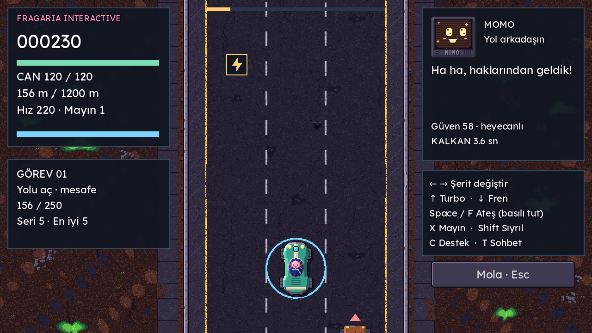
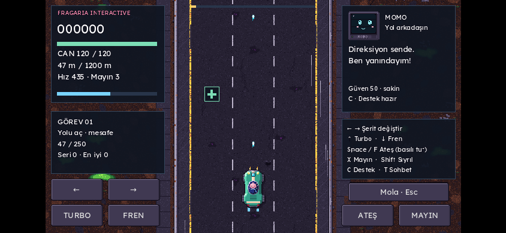

# Arcade Forge · Geliştirme ve doğrulama kaydı

12 Kasım 2026 · Kaynak tabanı `f7fd67082eec6609a66b5e8c40dc5dcea774925f` · Yeni sürüm 0.2.0

## İnceleme sonucu

0.1 sürümünde her harf oyun zamanını %10'a indiren komut kutusunu açıyordu. Şerit değişimi dahi MOMO'nun ruh haline bağlı olarak gecikebiliyordu. HUD metni yolun üstüne taşıyor, amaç yalnızca ölüm gelene kadar ilerlemekti. İkmal çizimleri vardı fakat seferde toplanan destek döngüsü yoktu. Duraklatma, doğrudan dokunmatik sürüş ve ses geri bildirimi yoktu.

Kullanıcının yeni kararı tasarımı değiştirir: anında ok tuşlu sürüş birincildir. MOMO kişilik, ilişki ve garaj hafızasını taşır. İsteğe bağlı sohbet T ile açılır; eski parser testleri korunur. Direksiyon/silah/kaçışın doğrudan girdileri MOMO yorumuna girmez.

## Fragaria / Aionverse kaynaklarının kullanımı

- Drive proje rehberi (özel referans public pakette yok): doğru repo ve yedek yapısı bulundu. Eski yedekler değiştirilmedi.
- [Aion Endless Run](https://github.com/kaansavukduran/aion_endless_run), mevcut README: net doğrudan kontrol, mola, çoklu dokunma, yerel tercihler ve görsel okunabilirlik referansı.
- Save the Planet geliştirme briefi (özel referans public pakette yok): Fragaria Interactive yayıncı adı, kanonik karakterleri koruma, renk yanında şekil, odak kaybında mola ve doğrulama dürüstlüğü ilkeleri. Başka oyuna ait hikâye/bölüm kapsamı bu oyuna taşınmadı.
- Fragaria Classification System taslağı (özel referans public pakette yok): belge kendi kapsamını sınıflandırma olarak tanımlıyor; kalite sertifikası sayılmadı, kayıt kimliği uydurulmadı.

0.2 incelemesinde bağımsız standart henüz bulunamamıştı. Kullanıcının daha sonra verdiği resmî AIONIA klasörüne erişildi; 00_BAŞLA ve standart v1.0 ile 19 görsel incelendi. 0.3 için AIONIA_STANDARD.md, ART_BIBLE.md, GAME_DESIGN.md, LORE_LINKS.md ve QA.md bu tarihli notun önüne geçer. Bu bir sertifikasyon iddiası değildir. Mevcut Aion / Ömer, MOMO, araç ve çevre paftaları değiştirilmedi. Lexend ana yazı tipi korundu, dört ok glifi için lisanslı küçük bir DejaVu alt kümesi eklendi. Fragaria Interactive ve Aionverse isimleri garajda; Fragaria adı sürüş HUD'ında görünür.

## Yeni oyun döngüsü

1. Garajda doğrudan Space ile zırhlı hızlı sürüş veya diyalog + yükseltme.
2. Oklarla şerit değiştir; yukarı okla sınırlı enerji kullanarak turbo, aşağı okla fren. Boşluk/F basılıyken ön/arka en yakın tehdide ateş. X mayın, Shift sıyrılma, C destek.
3. Onarım, enerji/mayın ve tek darbeyi emen kalkan kapsüllerini topla. Şekiller renk bilgisi olmadan da ayırt edilir.
4. Seri puanını büyüt; hasar veya beş saniyelik seri boşluğu çarpanı sıfırlar. Mesafe, düşman ve ikmal görevleri sırasıyla gelir; ödülleri bir kez verilir.
5. 1.200 metrede başarı; ölümde tekrar deneme. Sonuç ekranından tek adımda yeniden sür veya garaja dön. Rekor, güven, hafıza ve tercihler yerelde kalır.

Tüm yeni denge sayıları `data/balance.json` içindeki `run.arcade` alanındadır. Puan/görev mantığı sahneden bağımsız `scripts/core/arcade.gd` içindedir. Yeni sesler dış örnek içermeyen kısa sentezlerdir; müzik eklenmedi.

## Doğrulama

Godot 4.6.3 / Linux çalışma ortamında altı test takımı: parser 110, MOMO 89, garaj/kayıt 72, mevcut sefer 14, yeni arcade sahnesi 32, tam sefer 4; **321 başarılı, 0 başarısız**. Gerçek sahneye klavye ve iki parmak olayları gönderilir. Küs MOMO sırasında gecikmesiz sürüş, turbo tüketimi, fren, ateş/mayın, mola, ayrı parmakların bırakılması, gerçek kapsül çarpışması, tek darbeli kalkan, görev, başarı, ödülün tek verilmesi, rekor ve tercih kaydı sınanır. Sabit 42 tohumlu tam sefer simülasyonunda basit ateş/turbo/ikmal takip stratejisi, 91,15 oyun saniyesinde 1.200 metreye ulaştı: 31 düşman, 17 kapsül, 6 görev ve 5.640 puan. Bu otomatik simülasyondur; insan oyuncu testi değildir.

```sh
bash tests/run_all.sh
python3 packaging/build_web.py
python3 -m http.server 8765 --directory build/web
# Ayrı terminal, Playwright kuruluysa:
DBW_CHROMIUM=/usr/bin/chromium node tests/browser_smoke.cjs
```

Yazma kısıtlı ortamlarda Godot'un XDG_DATA_HOME, XDG_CONFIG_HOME ve XDG_CACHE_HOME yollarını proje içindeki geçici `work/runtime/` altına yönlendirmek gerekir. Test kayıtları oyuncunun gerçek kaydını değiştirmeyen ayrı adlar kullanır.

Web export resmî SHA-512 doğrulamalı şablonlarla üretildi. Derleme kontrolü hem garajı hem gerçek sefer sahnesini açar ve script hatalarında durur. Chromium 1280×720 masaüstü ve 844×390 dokunmatik emülasyonda çalıştırıldı. Mola sırasında yol görüntüsünün sabitliği ve tarayıcı hata kaydı kontrol edilir; ekran görüntüleri ayrıca incelendi. İki parmakla turbo ve ateş aynı anda kullanılabilir. Fiziksel cihaz testi veya insan oyuncu eğlence testi yapılmış sayılmaz.





## Teslim ve sınırlar

Web ZIP'i HTTP sunucusundan oynanır; çift tıklamayla açılmaz. Kaynak ZIP'i Godot projesidir. GitHub geliştirme dalı ana sürümden ayrıdır. Bu çalışma üretim Vercel sitesini değiştirmez ve yeni Windows/Linux/Android native paketi yayımlamaz. Bu hedeflerin mevcut CI/export profilleri korunur; fiziksel kumanda ve telefon, Safari, native kurulumlar ve insanlarla uzun denge testi sonraki doğrulama hedefleridir. Oyun arayüzü Türkçedir. Dikey telefonda alan küçülür; yatay ekran önerilir.

Drive önizleme paketleri (özel teslim; bağlantı kullanıcıyla ayrıca paylaşılır): kaynak, web ve doğrulama arşivi. Eski kaynak yedekleri aynı kimlik ve konumlarıyla korundu.

## 0.3 · Resmî AIONIA uyarlaması

Resmî kaynaklar kullanıcı tarafından sağlandıktan sonra ana menü, yardım, ortak ayarlar, ses düzeyi, dekoratif hareket seçimi, yükleme/hata akışı ve marka hiyerarşisi uygulandı. 332 kontrol PASS. Bulut yazılım renderer 60 FPS hedefi FAIL; fiziksel cihaz ve üretim yayını NOT TESTED. Ayrıntı QA.md içindedir.

0.3 AIONIA teslimleri (özel teslim; bağlantı kullanıcıyla ayrıca paylaşılır) · Önceki 0.2 paketleri korunur.

## 0.4 · Evrensel kalite, kontroller ve yerel veri

Yeni resmî belge okundu; erişimde başlık v1.2 olduğundan istenen v1.1 kapsamıyla birlikte kayda geçirildi. Amaç/kitle/teknoloji ve açıklar DESIGN_BRIEF.md'de. Analog/tetikleyici, A/B menü akışı, yeniden atama, ölü bölge, otomatik ateş, titreşim tercihi, üç sekmeli ayarlar, veri sıfırlama, güvenli onay, kayıt yedeği ve arıza koruması eklendi. Web yardım metni semantiktir; düşük güç modu aynı ekran alanında daha küçük arka tampon kullanır. Android public prototype imzası fallback'i kaldırıldı.

390 otomatik kontrol PASS. Yazılım renderer normal mod 60 FPS kapısı FAIL; düşük güç 30 FPS ara hedefi PASS. Fiziksel cihaz/yardımcı teknoloji/insan eğlence testi ve üretim yayını NOT TESTED. Ayrıntılar QA.md'de.

0.4 teslimleri (özel teslim; bağlantı kullanıcıyla ayrıca paylaşılır). 0.2 ve 0.3 yedekleri korundu.

## 0.5 · Onaylı kaydırma ve Eve Giden Yol

Kullanıcı son olarak telefon/tablette sağa/sola kaydırma + eylem düğmelerini seçti; önceki joystick isteği bu seçimle değişti. PC oklar/WASD ve yol alanında fare, gamepad analog/D-pad/tetikleyici akışı korunup doğrulandı. Dikey/yatay ekran için Godot içerik boyutu ve UI yerleşimi uyarlanır. Kontrol kararı CONTROLS.md ve AGENTS.md'de kayıtlıdır.

İlk hikâyeli bölümde yol öncesi iki tercih gerçek can/mayın desteğini ve hedefi değiştirir; mesafe diyalogları, molada okunabilen günlük, hedefe bağlı son ve yerel bölüm hafızası vardır. Yeni kanon onayı iddiası yoktur. JOURNEY.md tasarım sınırını açıklar.

429 headless kontrol / 11 takım PASS. Chromium PC, telefon/tablet dikey-yatay, düşük güç telefon ve emüle gamepad akışları PASS. Normal 60 FPS yazılım renderer hedefi FAIL; düşük güç 30 FPS ara hedefi PASS. Fiziksel/yardımcı teknoloji/insan eğlence testleri NOT TESTED. Ayrıntılar QA.md ve teslim kanıtlarında.

0.5 kaynak, web ve doğrulama teslimleri (özel teslim; bağlantı kullanıcıyla ayrıca paylaşılır). Önceki sürümler korunur.

## 0.6.0 · Yolun Hafızası

Kullanıcı Öneri 1'i tekrar onayladı ve üç karar üzerinden ilerleyen 13 sonlu arcade hikâye ile MOMO yerine yeni AI istedi. İLİN özgün hafıza pusulası silueti ve yeniden yazılmış sakin/kararlı replikleriyle eklendi. Üç 400 m etap, etaba göre düşman açılışı ve karara göre kaynak/ikmal/trafik etkileri; kampanya kaydı, yeniden deneme ve kazanılan sonlar kitabı mevcut Godot altyapısındadır. Yeni karakter/hikâye OYUN/TASLAK, ana kanon onayı değildir.

Standart bağlantısında güncel başlık v1.5 bulundu. Varsayılan koyu, açık/sistem tercihi ve tek paylaşılan UI teması eklendi. Native sistem fontu/HTML system-ui çalışır; Web Canvas OS font dosyalarına erişemediğinden gömülü yedek kullanır. Bu sınır QA'da açık FAIL'dir. Çilek JPG'si aynen korunan Fragaria yükleyicisi byte/ResourceLoader ilerlemesini gösterir; bilinmeyen yüzde uydurulmaz. Onaylı final logo kompozisyonu bulunmadığı kaydedildi.

744 headless kontrol; 13×3 gerçek arcade etabı ve gamepad ile tam kitap UI akışı PASS. Tam web hikâyesi gerçek girdilerle e01'e ulaştı, sonlar dokunmayla okundu ve reload sonrası korundu. Güncel performans ve platform sınırları QA.md içindedir. Kaynak/oynanabilir web/doğrulama paketleri tam Git geçmişini içermez; özel teslim bağlantıları public PR'a yazılmaz.

0.6 uzak teslim durumu: otomatik onay denetimi özel Drive JPG’sini, bir test PNG’sini ve ardından özel referans bağlantıları içeren kaynak ağacının public GitHub aktarımını reddetti. Reddin çevresinden dolaşılmadı; public dal/PR güncellenmedi. Tam çalışan yerel kaynak/web/doğrulama paketleri hazırlanır. Public dağıtım onayı kaynak, referans bağlantıları ve görseller için ayrıca beklenir.

## 0.6.1 · Adil rastgelelik ve okunabilir saldırılar

Görsel hareket açık/kapalı iki aynı koşu eski kodda ilk fizik adımında ayrıştı. Kamera/dekor/konuşma RNG'si trafikten ayrıldı; 60 saniyelik gerçek sahne karşılaştırması aynı trafik, ikmal, can, puan ve fizik durumunu koruyor. Nişan çizgisi, engel hazırlığı ve şerit kırma işaretleri native Godot katmanında eklendi. Yatay mermi birikmesi ve arka takipçiye atışın erken silinmesi düzeltildi. Yeni otomatik testler QA.md içindedir. Bu güncellemede dışarıya paylaşım denenmedi; yerel paket hazırlanır.
