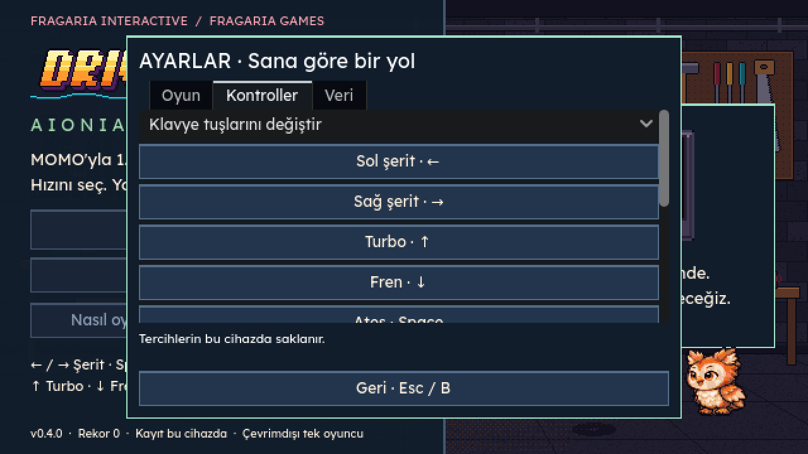
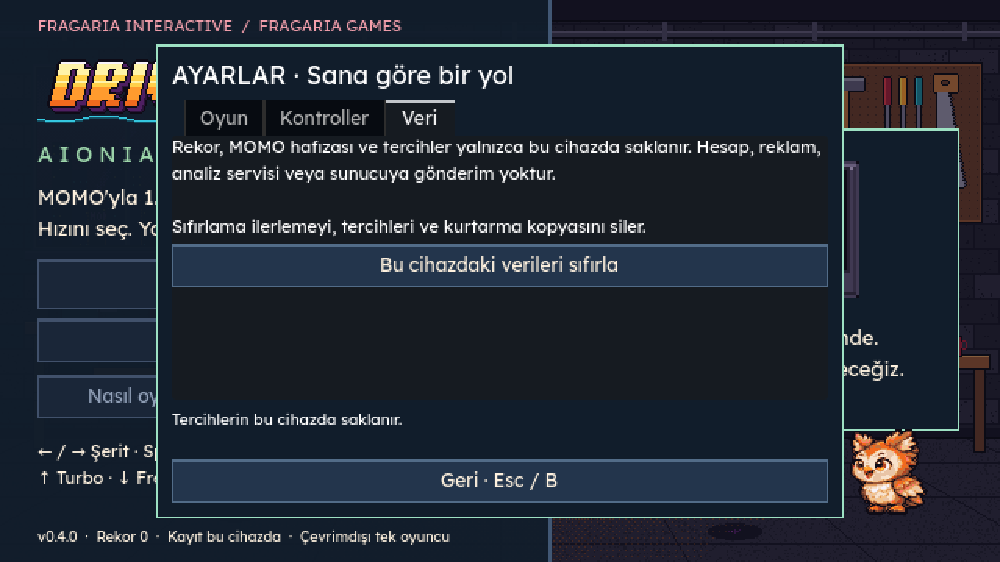
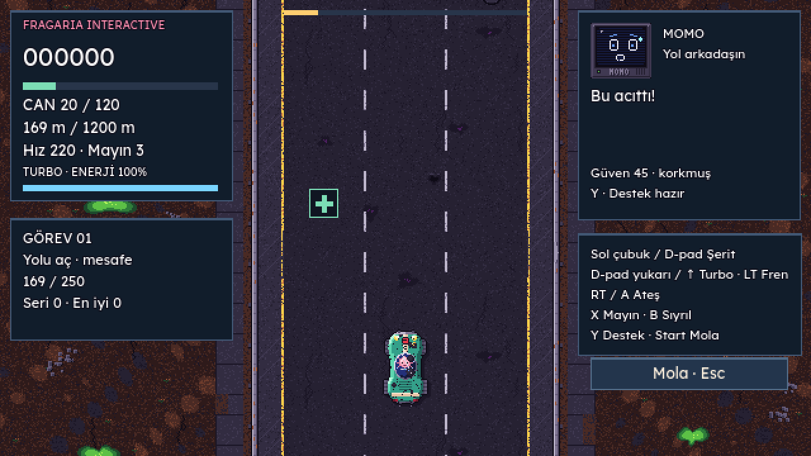
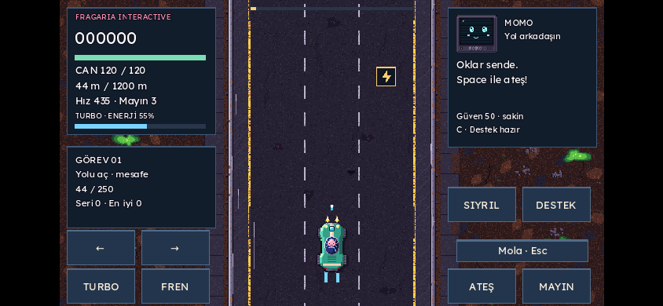

# AIONIA kalite kapıları · Drive-By Wire 0.4.0

12 Kasım 2026. PASS yalnız çalıştırılmış/gözlenmiş kapsamdır; FAIL karşılanmayan hedeftir; NOT TESTED denenmeyen kapsamdır. Önizleme tam yayın onayı veya genel erişilebilirlik sertifikası değildir.

| Senaryo | Sonuç | Kanıt ve sınır |
| --- | --- | --- |
| Güncel standart erişimi, amaç/kitle/teknoloji incelemesi | PASS | Verilen Google Doc okundu; başlığı v1.2, içinde istenen v1.1 kuralları var. DESIGN_BRIEF.md ve AIONIA_CURRENT_REFERENCE.md. |
| Özgün karakter/çilek için kesin kanon onayı | NOT TESTED | Önceki 00_BAŞLA incelemesinde onay bekleniyor; onaysız varyant kesinleştirilmedi. Yeni karakter/logo çizilmedi. |
| Mevcut Godot altyapısını ve görsel kimliği koruma | PASS | Godot 4.6.3, mevcut art ve JSON denge verileri; yeni motor/framework/runtime bağımlılığı yok. |
| Parser / MOMO / garaj-kayıt | PASS | 110 / 89 / 72 kontrol. |
| Eski sefer / arcade / tam sefer / başlık UI | PASS | 14 / 32 / 4 / 11 kontrol. Çalışan 1.200 m sefer korunur. |
| Kayıt kurtarma ve arıza enjeksiyonu | PASS | 18 kontrol: bozuk/kayıp/512 KiB üstü dosya, rename hatasında mevcut kaydın korunması, yeni şema üzerine yazmama, dosya temizliği, sonlu sayı ve giriş sınırları. |
| Kontrolcü sahne akışı | PASS | 31 kontrol: A ile başla; analog drift/histerezis; RT ateş; X/Y; Start mola; B geri; ayar sekmesi; ayrılma onayını iptal; otomatik ateş; kopma/bağlanma; yeniden atama; sonuç/garaj/yükseltme/menü. Bunlar enjekte edilmiş Godot olaylarıdır. |
| Ayar, yeniden atama ve veri sıfırlama UI | PASS | 9 kontrol: birleşen yazım, çakışma açıklaması, J yeniden atama/kayıt/etiket, Esc iptal, güvenli onay odağı, iptalde koruma, onayda yedek dahil silme ve varsayılan kontrol. |
| Otomatik kontrol toplamı | PASS | **390 başarılı, 0 başarısız; 10 takım.** Testler ayrı geçici XDG deposunda çalışır, oyuncunun gerçek kaydına yazmaz. |
| Web masaüstü ve çoklu dokunma | PASS | Chromium 1280×720 ve 844×390 emülasyon; oklar, basılı ateş, iki parmakla turbo+ateş, mola sırasında sabit yol. Tarayıcı runtime hata listeleri boş. |
| Web yükleme hatası ve tekrar deneme | PASS | index.pck isteği engellendi; görünür hata/yeniden dene; engel kalkınca aynı akışla başarılı başlangıç. |
| Ses açılışı / ayarlar | PASS | Kullanıcı girdisinden sonra AudioContext running; ses düzeyi/kapatma kaydı gerçek UI testiyle doğrulandı. Fiziksel hoparlör değerlendirmesi değildir. |
| Tarayıcı Gamepad API yolu | PASS | navigator.getGamepads + bağlantı olayı taklidiyle A → oyun, Start → mola; normal ve düşük güç modunda yol sabitliği. Fiziksel kumanda değildir. |
| Düşük güç tercihi gerçek web UI → tekrar açılış | PASS | Ayar düğmesine tıklama → localStorage → reload → 640×360 arka tampon, 1280×720 görüntü. Sıfırlama iptali tercihi korur. |
| Semantik web yardım, odak ve %200 metin | PASS | HTML yardım klavye odağı alır, metin yatay taşmadan yeniden akar. Açılınca oyun molaya geçer; kapatınca kendiliğinden sürmez. Bu, oyun canvas'ının tamamında ekran okuyucu desteği anlamına gelmez. |
| 60 FPS normal mod hedefi | FAIL | GPU bulunmayan SwiftShader ortamında normal mod örnekleri 19 / 19 / 18 FPS; medyan 19. 60 Hz fizik render başarısı sayılmadı. |
| Düşük güç modunda en az 30 FPS ara hedefi | PASS | Aynı 1280×720 viewport ve aynı yazılım renderer: 640×360 tamponla 33 / 35 / 40 FPS; medyan 35. Yazı/çizim keskinliği azalır; seçenek isteğe bağlı ve normal mod varsayılandır. Gerçek cihaz garantisi değildir. |
| Bellek toplamı ve gerçek GPU/telefon FPS | NOT TESTED | CDP JS heap ~9,6–9,7 MB yalnız JS kısmıdır; WASM/GPU ve toplam bellek değildir. Godot release static-memory sayacı 0 döndürür, toplam bellek diye kullanılmaz. |
| Fiziksel gamepad/titreşim, telefon, Safari, native kurulum | NOT TESTED | Gerekli cihazlar bu ortamda yok. Analog/düğme eşlemeleri veya tarayıcı emülasyonu bu kapıyı geçirmez. |
| Tam ekran okuyucu ile oynama / WCAG AA / her hedefte büyük yazı | NOT TESTED | Canvas oynanışı, bütün menü/HUD ve gerçek yardımcı teknolojiyle uçtan uca denetim yapılmadı. Türkçe UI; tam dil seçimi yok. Dikey telefonda alan küçülür. |
| İnsan oyuncu eğlence ve uzun denge testi | NOT TESTED | Sabit tohumlu tam sefer ve otomatik kontroller insan değerlendirmesi yerine sayılmadı. |
| Yerel veri, ağ isteği ve yayın imzası incelemesi | PASS | Test edilen iki web oturumunda üçüncü taraf istek yok; hesap/analiz SDK'sı yok. Yerel sıfırlama testli. Android public-key fallback kaldırıldı; kaynak ağaçta prototip anahtarı yok. Geçmişteki anahtar hâlâ açıktır. |
| Gerçek sahip Android imzası ve üretim güvenlik başlıkları | NOT TESTED | CI yapılandırması düzenlendi; gizli sahip anahtarı kurulmadı. Vercel başlıkları üretimde denenmedi. |
| Temiz web build ve yerel HTTP açılışı | PASS | Resmî SHA-512 doğrulamalı Godot/şablon, başlık+sefer smoke; script hatası yok. |
| Yeni CI platform çıktıları / canlı üretim yayını | NOT TESTED | Yeni native kurulum paketleri bu yerel çalışmada üretilmedi; main birleştirilmedi, üretim yayımlanmadı. |

## Ölçüm ve tekrar üretim

Aynı tarayıcı/viewport karşılaştırması: normal ilk yükleme 2.407 ms, düşük güç 1.944 ms. İkinci oturumda tarayıcı/disk önbelleği etkisi olabilir; bunlar internet/Vercel ilk ziyaret ölçümü veya düşük gücün yüklemeyi hızlandırdığına kanıt değildir. WASM yaklaşık 37,70 MB, PCK yaklaşık 0,60 MB; büyük Drive referans paftaları runtime'a gömülmez. İndirme sıkıştırması ve toplam paket boyutu ayrı teslim manifestindedir.

```sh
bash tests/run_all.sh
python3 packaging/build_web.py
python3 -m http.server 8765 --directory build/web
DBW_CHROMIUM=/usr/bin/chromium node tests/browser_smoke.cjs
DBW_CHROMIUM=/usr/bin/chromium node tests/browser_quality.cjs
DBW_CHROMIUM=/usr/bin/chromium node tests/browser_settings.cjs
```

Browser testleri mevcut Playwright kurulumunu kullanır; `NODE_PATH` ortamın kurulumuna göre ayarlanır. Yeni runtime bağımlılığı eklenmedi. Görüntüler ve JSON/log kanıtları verification ZIP'indedir. Test sonucu yalnız ilgili kaynak/paket sürümü için geçerlidir; değişiklikten sonra gereken testler tekrarlanmalıdır.










Yayın öncesi açık kapılar: gerçek hedefte 60 FPS/kare süreleri/toplam bellek, fiziksel kontrolcü ve mobil doğrulama, yardımcı teknoloji testi, insan oyuncu dengesi ve sahip imzası. Bu sürüm incelenebilir bir önizlemedir.
