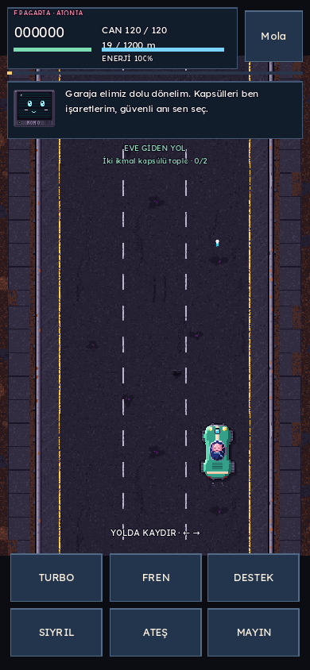
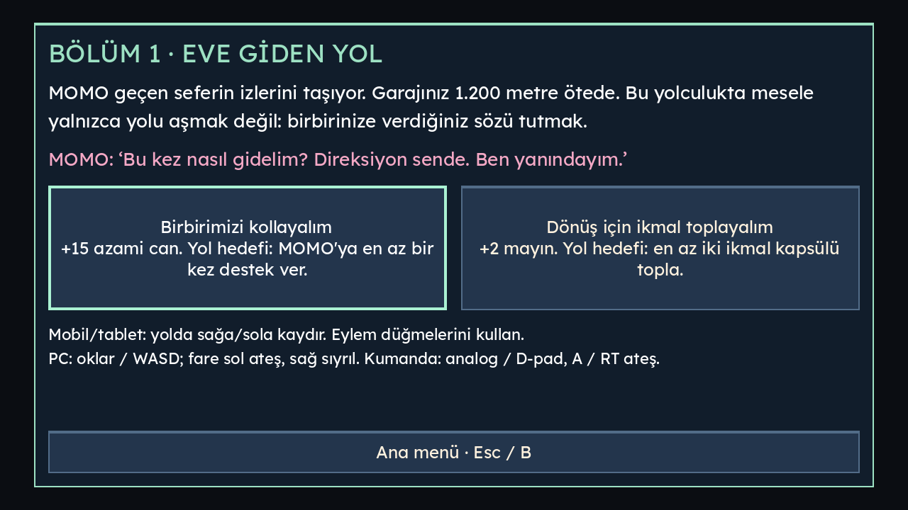
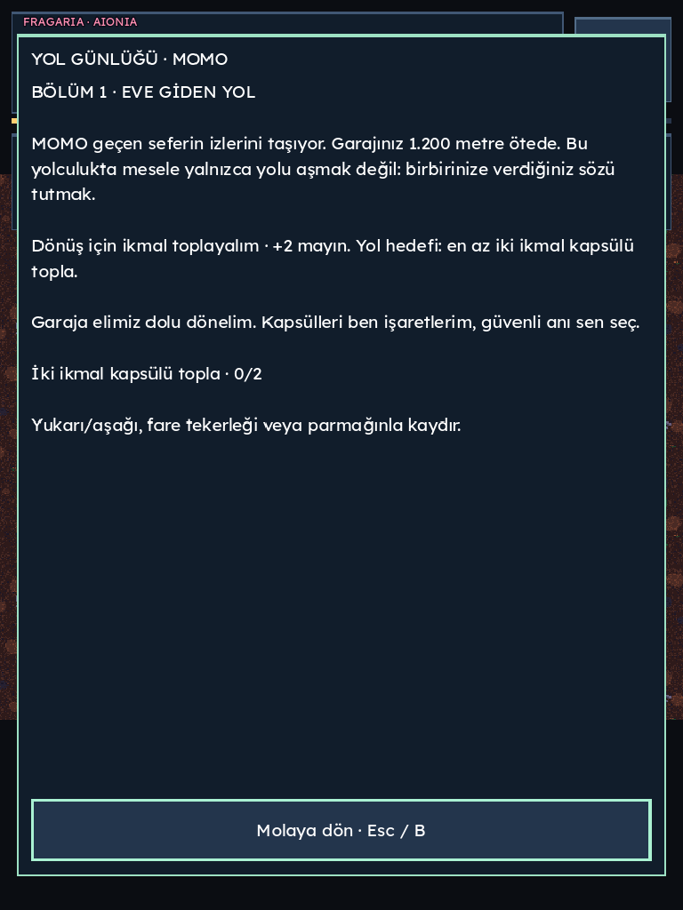
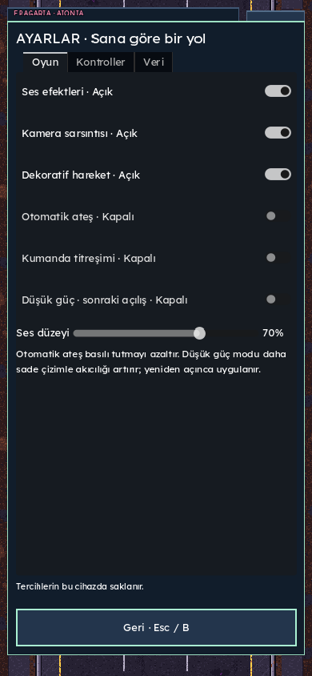

# AIONIA kalite raporu · Drive-By Wire 0.5.0

12 Kasım 2026. PASS çalıştırılmış kapsamı; FAIL karşılanmayan hedefi; NOT TESTED denenmeyen kapsamı gösterir. Tarayıcı emülasyonu fiziksel cihaz veya genel erişilebilirlik sertifikası değildir.

| Kontrol | Sonuç | Kanıt / sınır |
| --- | --- | --- |
| Kontrol şeması öncesi tür/ergonomi analizi ve açık seçim | PASS | CONTROLS.md: dört tarz karşılaştırıldı. Son kullanıcı seçimi kaydırma + eylem düğmeleri; önceki joystick isteğinin yerini aldı. AGENTS.md gelecekte de onay kuralını korur. |
| Godot, mevcut karakterler ve AIONIA kimliği | PASS | Godot 4.6.3/GDScript korundu. Yeni motor, framework, hazır grafik paketi veya karakter/logo varyantı yok. |
| Parser / MOMO / garaj-kayıt | PASS | 110 / 89 / 72 kontrol. Eski kayıtlar yeni bölüm alanlarını varsayılanlarla açar. |
| Sefer / arcade / tam sefer / başlık UI | PASS | 14 / 32 / 4 / 11 kontrol. Gerçek 1.200 m sefer, çatışma, ikmal, ödül, tekrar ve kayıt. |
| Kayıt kurtarma / kontrolcü akışı / ayarlar | PASS | 18 / 32 / 9 kontrol. Yeni yol tercihi ekranı da kontrolcü akışında doğrulandı. |
| Kaydırma, PC fare/WASD ve hikâyeli bölüm | PASS | 38 kontrol: eşik, titreşim, dikey/çapraz ret, tek hareket/tek şerit, parmak sahipliği, bağımsız ateş, mola iptali, fare HUD koruması, iki gerçek kaynak etkisi, diyalog eşikleri, günlükte durma, farklı sonlar, kaydın tek işlenmesi. |
| Headless toplam | PASS | **429 başarılı, 0 başarısız; 11 takım.** İzole geçici XDG kaydı. Script hatası varsa koşucu sonucu başarılı saymaz. |
| PC gerçek web girdisi | PASS | Chromium 1280×720: oklar, A/D, W turbo, S fren, fare sol basılı ateş, yol dışında bırakma ve fare sağ sıyrılma. Menü/ayar/günlük yolları. |
| Telefon dikey ve yatay | PASS | Chromium 390×844 / 844×390 emülasyonunda başla → iki hikâye tercihi → sürüş → ayarlar/günlük. Kaydırma + ateş ve turbo + ateş; dikey hareketin reddi; görünür düğme sınırları. |
| Tablet dikey ve yatay | PASS | Chromium 768×1024 / 1024×768 emülasyonunda aynı ana akış; klavye/fare gerektirmeyen dokunma olayları. |
| Düşük güçte dikey telefon | PASS | 390×844 görüntü alanında 360×640 tampon; okunabilir ayrı dikey yerleşim, aynı dokunma ve menü akışı. |
| Sürüş sırasında ekranı döndürme | PASS | Dikey telefon → yatay: yerleşim yenilenir, dünya molaya geçer, eski ateş/gesture durumu temizlenir. Kullanıcı devam eder. |
| Browser Gamepad API | PASS | D-pad/A ile garaj, diyalog, yükseltme, yol tercihi; analog şerit, RB turbo + RT ateş; Start/B mola/geri; kopunca mola ve bağlanınca otomatik sürmeme. Bu API taklididir; fiziksel kumanda değildir. |
| UI sınırları ve modal katmanlar | PASS | Altı ekran düzeninde gerçek Godot düğme/panel sınırları denetlendi. Ekranlar incelendi; ayar yüksekliği ve HUD'nin modal üzerine çizilmesi düzeltildi. |
| Yükleme hatası → yeniden dene | PASS | index.pck isteği engellendi; hata düğmesi görüldü; engel kalkınca yeniden dene ile başlangıç. |
| Ses başlangıcı | PASS | Kullanıcı girdisinden sonra Web AudioContext running; ayar/kayıt testleri. Fiziksel hoparlör kalitesi değerlendirmesi değildir. |
| Düşük güç tercihi / veri onayı | PASS | Gerçek web UI → yerel tercih → reload → düşük güç; veri silme penceresini iptal edince tercih korunur. Onaylı dosya silme native UI testinde doğrulandı. |
| Semantik HTML yardım / %200 metin | PASS | Odak, yatay taşmadan metin akışı, yardım açılınca mola ve kapatınca molada kalma. Tam canvas ekran okuyucu oyunu değildir. |
| Yazılım renderer normal mod 60 FPS | FAIL | 1280×720 SwiftShader, GPU yok: 18 / 19 / 19 FPS; medyan **19**. 60 Hz fizik adımı render başarısı sayılmaz. |
| Düşük güç 30 FPS ara hedefi | PASS | Aynı viewport, 640×360 tampon: 32 / 36 / 36 FPS; medyan **36**. Keskinlikten ödün verir, isteğe bağlıdır. Gerçek GPU garantisi değildir. |
| Fiziksel telefon/tablet/gamepad/titreşim ve Safari | NOT TESTED | Bu donanım/tarayıcılar ortamda yok. Emülasyon sonuçları fiziksel test diye sunulmaz. |
| İnsan oyuncu eğlence/denge/anlatı değerlendirmesi | NOT TESTED | Otomatik tam sefer insan değerlendirmesi değildir. Bu, çalışan ilk hikâyeli bölümdür; çok bölümlü kampanya iddiası yok. |
| Tam ekran okuyucu/WCAG AA ve gerçek cihaz bellek/enerji | NOT TESTED | Yardım metni dışında tam yardımcı teknoloji denetimi yok. CDP JS heap 9,5–12,1 MB yalnız JS kısmıdır; WASM/GPU/toplam değildir. Godot static-memory 0 raporunu toplam bellek saymadık. |
| Windows/Linux/Android native kurulum ve sahip imzası | NOT TESTED | Bu sürümde yeni native kurulum paketi üretilmedi veya fiziksel cihazda açılmadı. Sahip Android imzası olmadan public-key fallback yok. |
| Kaynak, mahremiyet ve web paketleme | PASS | Yerel bölüm/rota kaydı mevcut SaveStore sınırlarıyla tutulur; yeni hesap/SDK/API/telemetri yok. Testte üçüncü taraf ağ isteği yok. Resmî Godot şablonu ile web build ve script smoke başarılı. |
| Üretim yayını / main birleşimi | NOT TESTED | Geliştirme dalı ve taslak PR kullanılır. PR önizlemesinin uzak doğrulaması ayrıca teslim kanıtında kaydedilir; üretim onayı sayılmaz. |

## Tekrar üretim

```sh
bash tests/run_all.sh
python3 packaging/build_web.py
python3 -m http.server 8765 --directory build/web
DBW_CHROMIUM=/usr/bin/chromium node tests/browser_forge.cjs
DBW_CHROMIUM=/usr/bin/chromium node tests/browser_quality.cjs
DBW_CHROMIUM=/usr/bin/chromium node tests/browser_smoke.cjs
DBW_CHROMIUM=/usr/bin/chromium node tests/browser_settings.cjs
```

Playwright yalnız mevcut test aracıdır; NODE_PATH kurulumuna göre ayarlanır. ?qa bayrağı salt okunur yerel durum/rect gözlemi açar; testler oyuna değer enjekte eden bir API kullanmaz. Gerçek tuş/fare/Touch/CDP/navigator.getGamepads yollarından gider. Tam sefer, zaman ve bozuk dosya senaryoları ayrıca Godot sahne testindedir.

Yerel kalite ölçümünde açılış 2.466 ms / 1.831 ms; ikinci oturumda önbellek etkisi olabilir. Bu, internet performansı veya düşük gücün yüklemeyi hızlandırdığı iddiası değildir. Bellek ve fiziksel hedef performansı ayrıca ölçülmelidir. Ham JSON/loglar ve görüntüler verification ZIP'indedir.








