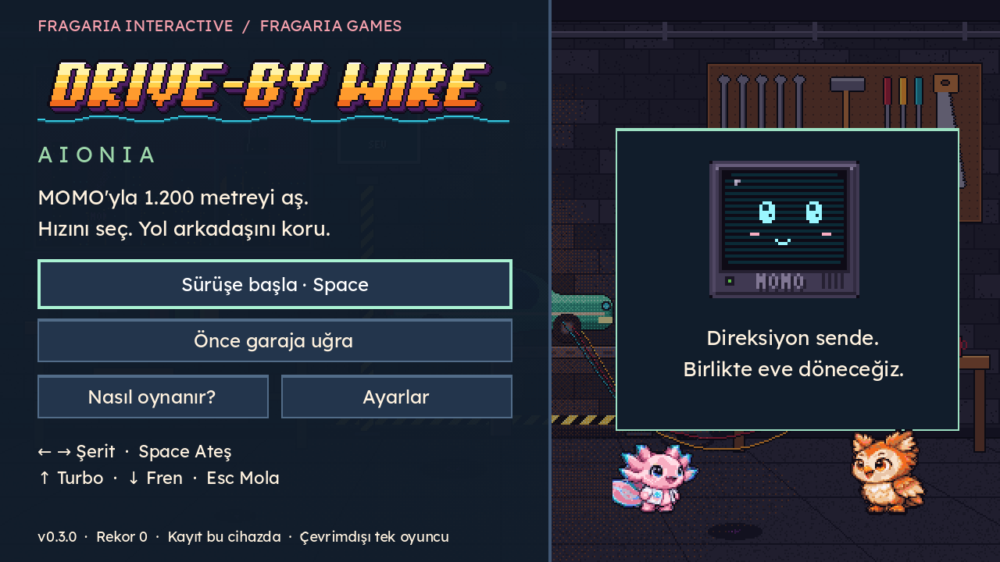
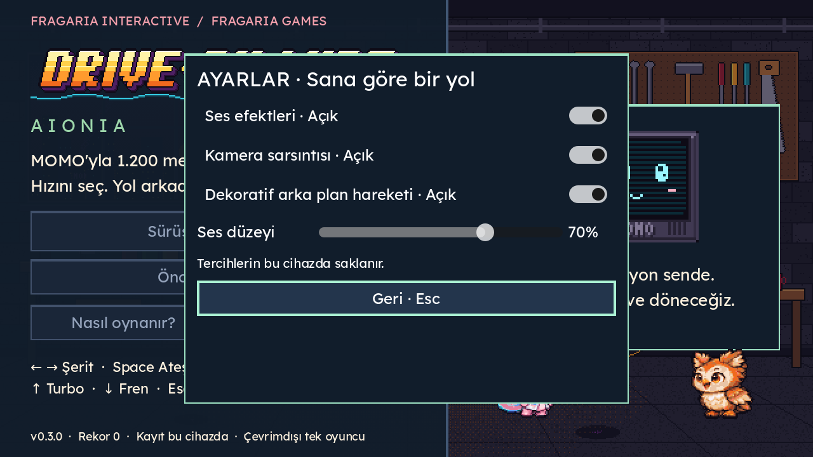
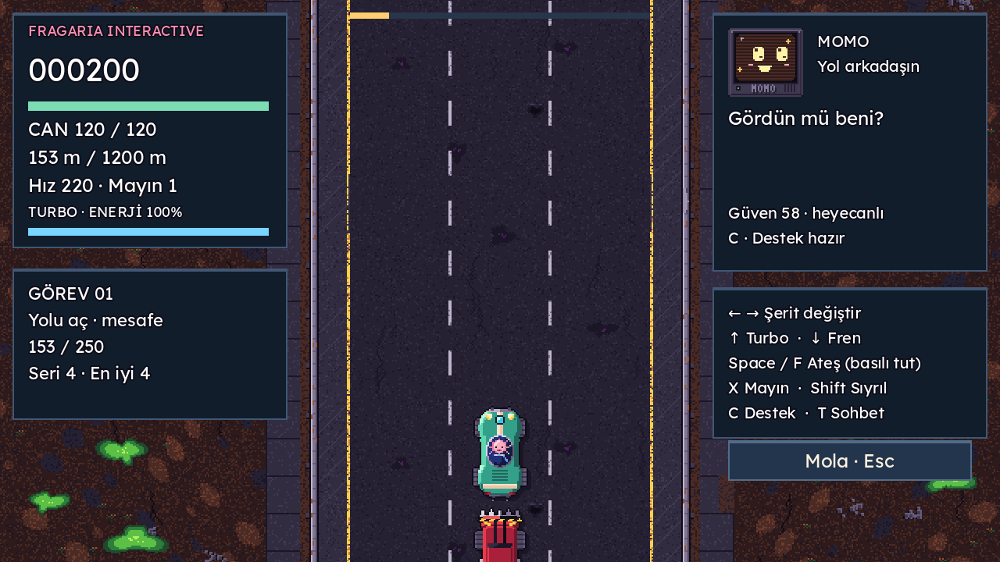
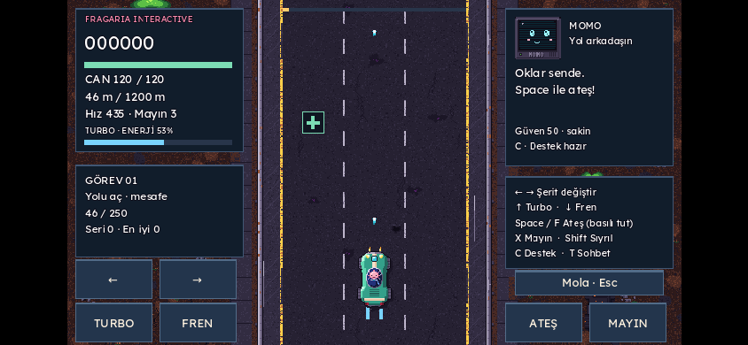
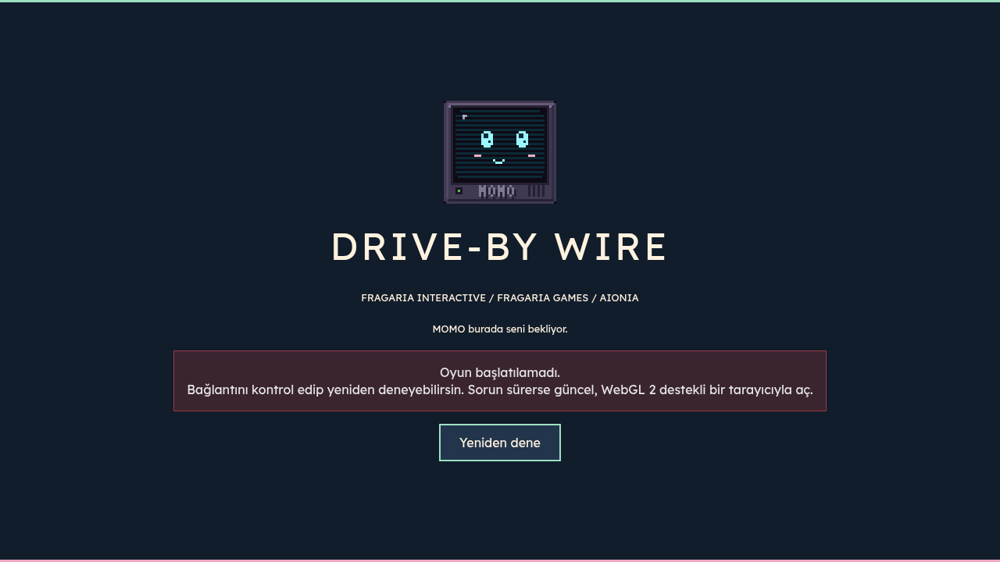

# AIONIA kalite kapıları · Drive-By Wire 0.3.0

12 Kasım 2026. Bu dosyada PASS yalnız çalıştırılmış/gözlenmiş kapsam içindir. FAIL açık kusur veya karşılanmayan hedeftir. NOT TESTED denenmeyen ya da eksik kaynağa bağlı kapsamdır. Önizleme tam yayın onayı değildir.

| Kapı / senaryo | Sonuç | Kanıt ve sınır |
| --- | --- | --- |
| A · Drive erişimi, 00_BAŞLA ve AIONIA v1.0 | PASS | Belgeler okundu; repo kopyası ve 19 görselin URL/SHA-256/boyut kayıtları var. |
| A · Son karakter/çilek logo kanonu | NOT TESTED | Başlangıç belgesi onayı bekliyor diyor; onaysız varyant kesinleştirilmedi. Emre sprite kaynağı bulunmadı. |
| B · Oyuncu vaadi, üç mekanik, kazanma/kaybetme, sanat/lore sınırı | PASS | GAME_DESIGN.md, ART_BIBLE.md, LORE_LINKS.md. |
| C · Gerçek kısa bölüm/sefer | PASS | Sabit tohumlu tam sefer gerçek düşman, ikmal, görev ve başarı ile tamamlandı. İnsan eğlence testi değildir. |
| D · Mevcut görsel kimliği koruma | PASS | Karakter paftaları değiştirilmedi; yeni hazır grafik paketi alınmadı. Yeni UI aynı kod stili ve paletle çizilir. |
| D · Yeni beş karakter animasyonu | NOT TESTED | Bu oyuna beş yeni oynanabilir karakter eklenmedi. Referansların varlığı animasyon entegrasyonu sayılmadı. |
| E · Parser / MOMO / garaj ve kayıt | PASS | 110 / 89 / 72 başarılı kontrol. |
| E · Eski sefer / yeni arcade / tam sefer / başlık UI | PASS | 14 / 32 / 4 / 11 başarılı kontrol. Toplam 332 PASS, 0 FAIL. |
| E · Gerçek klavye ve iki parmak olayları | PASS | Küs MOMO sırasında anında ok tuşu, turbo/fren, ön/arka ateş, mayın, ayrı parmak bırakma. |
| E · HUD, menü, yardım, ayar, mola | PASS | 1280×720 Chromium ekranları incelendi. Mola sırasında yol görüntüsü sabit. Arka menü odağı kapatılır; geri dönünce odak doğru düğmeye gelir. |
| E · Kayıt ve hata durumu | PASS | Rekor ve ses/hareket tercihleri kaydedilir; yazılamayan hedefte UI açıklama gösterir ve oturum ayarı uygulanır. |
| E · Yükleme hatası → Yeniden dene | PASS | index.pck isteği bilerek engellendi; hata ekranı gözlendi; engel kalkınca aynı düğmeyle açılış başarılı. |
| E · Ses başlatma | PASS | Chromium kullanıcı girdisinden sonra AudioContext running. Ses aç/kapat ve düzeyin UI/kayıt akışı testli. Fiziksel hoparlör/işitsel kalite testi değildir. |
| E · Türkçe, ok glifleri, kontrast, şekil işaretleri | PASS | Gerçek ekranlar; katı renkler için 15,41:1 ana metin, 11,29:1 düğme metni kontrast hesabı. |
| E · Telefon boyutunda emülasyon | PASS | Chromium 844×390, iki parmakla turbo+ateş ve mola. Fiziksel telefon testi değildir. |
| E · 60 render FPS hedefi, bulut yazılım renderer | FAIL | GPU cihazı bulunmayan SwiftShader ortamında son ölçüm 20 FPS; 60 Hz fizik adımı render başarısı diye sayılmadı. Viewport denemesi 24 FPS'e çıktı ancak yazı keskinliği için canvas_items korundu. |
| E · Bellek ve gerçek GPU/cihaz performansı | NOT TESTED | Godot release web static-memory sayacı 0 döndürüyor; bu değer gerçek bellek kullanımı olarak raporlanmadı. Fiziksel GPU/Windows/telefon ölçülmedi. |
| E · Safari, fiziksel gamepad ve insan oyuncu denge testi | NOT TESTED | Bu ortama erişim/katılımcı yok. D-pad eşlemesi uygulandı, fiziksel cihaz doğrulaması yapılmadı. |
| F · Temiz web build / yerel HTTP açılışı | PASS | Godot 4.6.3, resmî SHA-512 doğrulamalı web şablonu; başlık ve sefer smoke; Chromium runtime hata kayıtları boş. |
| F · Canlı Vercel URL / native yayın | NOT TESTED | Üretim yayımlanmadı; yeni native kurulum paketi bu çalışmada üretilmedi. CI/export kaynakları korunuyor. |

## Ölçüm ve tekrar üretim

Son yerel ilk ziyaret yükleme süresi 2.876 ms; internet üzerindeki Vercel performansı değildir. Paket dosyaları yaklaşık 37,70 MB WASM ve 0,58 MB PCK içerir; runtime'a büyük Drive referans atlasları gömülmedi. Sıkıştırılmış teslim boyutu teslim klasöründeki SHA256SUMS ve dosya boyutlarıyla doğrulanır. Tek örnek FPS/yükleme değeri bütün cihazların performans garantisi değildir.

```sh
bash tests/run_all.sh
python3 packaging/build_web.py
python3 -m http.server 8765 --directory build/web
DBW_CHROMIUM=/usr/bin/chromium node tests/browser_smoke.cjs
```

Browser testi Playwright'ın mevcut kurulumu ile çalıştırıldı. Yeni runtime bağımlılığı eklenmedi. Kısıtlı yazma ortamında XDG_DATA_HOME / XDG_CONFIG_HOME / XDG_CACHE_HOME proje içindeki geçici work/runtime alanına yönlendirildi. Ham sonuçlar teslimin verification ZIP'indedir.











Öncelikli açık iş: gerçek GPU'lu hedef cihazda profile alıp 60 FPS, kare süreleri ve bellek bütçesini doğrulamak; yazılım renderer sınırını kapatmak. Sonraki onay konusu: son karakter varyantları ve Fragaria çilek logosu. Bu açıklar tamamlanmış gösterilmez.
